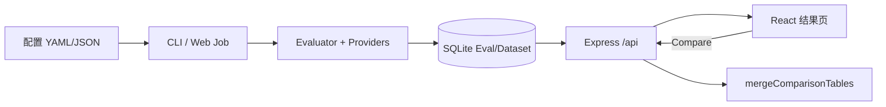

# AI Model Evaluation & Comparison Platform

# 项目介绍（简历 & 技术面试）

> 用途：求职简历、前端岗技术面试、讲清架构与个人贡献  
> 不是 README，也不是源码学习手册（详见 `docs/TECHNICAL-GUIDE.md`）  
> 英文名：AI Model Evaluation & Comparison Platform  
> 中文名：AI 模型评测与结果对比平台  
> 贡献边界（本文约定）：**源码分析 + 隔离环境 Mock 复现**；**无独立业务功能开发、无缺陷修复实施**  
> 冲突处理：文档与源码不一致时，以业务源码与 `tmp-comparison-run/` 实测为准

---

## 1. 项目基本信息

| 项 | 说明 |
|----|------|
| 项目名称 | AI Model Evaluation & Comparison Platform（AI 模型评测与结果对比平台） |
| 项目定位 | 本地优先的 LLM 评测与结果分析平台：配置化定义用例与断言，批量执行，本机落库，Web UI 浏览、筛选、导出，并支持多轮评测**并排对比** |
| 项目背景 | 换模型 / 改 prompt 后，缺乏可重复、可对比的评测证据；团队需要固定用例集上的 pass/fail/score 与历史对比 |
| 解决的问题 | ① 把「手测模型」变成可配置、可回归的评测流水线；② 把结果结构化入库与可视化；③ 在同类 dataset 下对比两次评测输出差异 |
| 技术栈（与源码一致） | **运行时** Node ≥22；**语言** TypeScript；**CLI** Commander；**HTTP** Express 5 + Socket.IO；**校验** Zod；**DB** SQLite + Drizzle ORM + `@libsql/client`；**评测引擎** 自研 Evaluator + 多厂商 Provider；**前端** React 19、Vite、React Router、Zustand、TanStack Query/Table/Virtual、Radix UI、Tailwind；**测试** Vitest 等 |
| 核心业务功能 | 配置加载与评测执行、Provider 模型调用、Assertions 评分、Eval/Dataset 持久化、结果列表与详情表、多 Eval Compare、CSV/JSON 导出、可选 redteam / model-audit 等扩展（扩展非本介绍重点） |

**说明**：仓库上游为开源评测工具链；环境变量等标识中的 `PROMPTFOO_*` 为**源码遗留键名**，简历中可统一使用上表产品化名称，面试被追问时如实说明基于开源码分析。

---

## 2. 项目整体介绍

### 2.1 为什么存在

应用侧频繁切换模型与 Prompt，若只靠对话手工试，无法复现、无法回归、无法量化差异。本平台用 YAML/JSON 固定 `providers` / `prompts` / `tests` / `assert`，批量跑评测、落本地库，再在 UI 里做表格分析与并排对比，让「这次是否比上次更好」有证据。

### 2.2 用户如何使用

1. 编写配置（用例 vars、断言、目标模型）。  
2. CLI `eval` 或 Web Job 触发执行。  
3. 引擎按展开矩阵调用 Provider、跑 Assertions，写入 `evals` / `eval_results`，并按 `tests` 快照关联 `datasetId`。  
4. `view` 打开本地 Web：看列表、详情表、筛选；点 Compare 选**同 dataset** 的另一评测并排看输出。  
5. 可选导出 CSV（对比导出与 table 共用合并逻辑）。

### 2.3 核心业务流程

```text
配置 → evaluate / Evaluator → Provider + Assertions
  → Eval.create（datasetId=sha256(tests)）+ eval_results（含 testIdx）
  → GET /api/results、GET /api/eval/:id/table
  →（可选）comparisonEvalIds → mergeComparisonTables（按 testIdx 拼 outputs）
```

### 2.4 主要技术架构

- **入口**：CLI（`entrypoint` / `main` / `commands/eval`）与 Express View Server（`server/server.ts`）+ React SPA（`src/app`）。  
- **执行层**：`doEval` → `evaluate` → `Evaluator`（分配 `testIdx`、并发与限流）。  
- **数据层**：领域模型 `Eval` / `EvalResult` + Drizzle schema；文件库 `promptfoo.db`；跨进程靠 `evalLastWritten` 信号 + Socket.IO 热刷新。  
- **展示层**：Zustand 结果页状态 + fetch 拼 query；Compare 对话框按 dataset 过滤列表。



---

## 3. 核心技术亮点

> 以下亮点以「我能讲清楚、有证据」为准；**原仓库已实现能力 ≠ 我从零写的功能**。个人动作集中在**调用链还原、契约分析、隔离复现**。

### 3.1 前端业务调用链（结果页 → 对比）

1. **原本存在什么问题**  
   对比入口分散在 Dialog、列表表、全局 store、table API 多个文件，面试或排障时容易只停留在「点了 Compare」层面。  
2. **为什么值得解决**  
   前端岗位要能说明状态从哪里来、请求参数如何组装、UI 过滤与后端契约是否一致。  
3. **我做了什么**  
   梳理 `ResultsView` → `EvalSelectorDialog` → `EvalsTable` → `store` 的完整链，并对照 TECHNICAL-GUIDE / 源码符号。  
4. **具体分析**  
   - 当前 eval 的 `datasetId` 用于对话框 `filterByDatasetId` / `focusedDatasetId`。  
   - 列表：`GET /api/results?datasetId=`，客户端可再滤一层。  
   - `setComparisonEvalIds` 后，store 对 table URL **重复 append** `comparisonEvalIds`。  
   - **不**把 datasetId 传给 table API。  
5. **如何验证**  
   读 `ResultsView.tsx`、`store.ts`、`EvalsTable.tsx`；与 learning 文档调用关系对照。  
6. **结果**  
   形成可讲解的前端权威路径：列表保护在 UI，硬合并在服务端。  
7. **面试怎么讲**  
   「对比不是单组件功能，而是选择器软约束 + store 拼参 + table 接口合并；我按文件把参数流画清楚了。」

### 3.2 API 与后端业务处理（table + results）

1. **问题**  
   列表 API 与详情/对比 API 职责不同，易被误认为「服务端也会校验 dataset」。  
2. **价值**  
   理解 BFF/本地一体服务下的契约分层与 Zod 边界。  
3. **我做了什么**  
   精读 `GET /api/results`、`GET /api/eval/:id/table`（含 csv 分支）、错误码分支。  
4. **过程**  
   - Results：`getEvalSummaries(datasetId?)` 可选过滤。  
   - Table：主 `getTablePage` → `indices = body.map(testIdx)` → 对比方 `getTablePage({ testIndices })` → `mergeComparisonTables`；缺失 comparison → 404；**无 dataset 字段**。  
   - CSV：`generateEvalCsv` 同合并与 `ComparisonEvalNotFoundError`。  
5. **验证**  
   `routes/eval.ts`、`server.ts`、Zod `EvalSchemas.Table.Query`。  
6. **结果**  
   明确「存在性校验有，一致性校验无」。  
7. **讲解**  
   「同一产品里，列表 API 帮 UI 筛 dataset，table API 只保证 eval 在不在，这是设计分层不是文档写漏。」

### 3.3 多 Eval 结果合并

1. **问题**  
   多列并排如何对齐、vars 以谁为准、缺行怎么办。  
2. **价值**  
   表格 DTO 与导出一致性，避免「前端自己拼列」的误解。  
3. **我做了什么**  
   精读 `mergeComparisonTables`：标签加 `[evalId]` 前缀；按 `testIdx` 找对比行；拼接 `outputs`；vars 始终主表；找不到则空洞不报错。  
4. **过程**  
   对照 `evalTableUtils.ts` 与 CSV 路径共用 merge。  
5. **验证**  
   源码 + 同 dataset 实测 200 对齐。  
6. **结果**  
   合并契约可一句话概括：**索引对齐，非内容对齐**。  
7. **讲解**  
   「像 SQL 上用行号 join，而不是用用例主键 join。」

### 3.4 评测结果对比机制与 `testIdx` 错配

1. **问题**  
   产品意图是同 dataset 对比；实现上对齐键仅为执行期 `testIdx`（展开后行号，含 var/repeat 占用）。顺序变化会产生新 `datasetId`（UI 通常不可选），但 API 直调仍 200 且可**静默错行**。  
2. **价值**  
   展示「UI 约定 ≠ 服务端不变量」的系统设计判断力；与数据一致性、防御层次相关。  
3. **我做了什么**  
   源码定位缺陷机制；用隔离库 + echo 四场景打穿；记录在 learning / `api-compare-results.json`；**未改业务代码修复**。  
4. **过程**  
   - `Eval.create`：`datasetId = sha256(JSON.stringify(config.tests||[]))`（顺序敏感）。  
   - `evaluator` 递增分配 `testIdx`。  
   - merge 只比 `testIdx`。  
5. **验证（实测摘要）**  

| 场景 | 实际结果 | 根因 | 影响 |
|------|----------|------|------|
| 同 Dataset | 200，对齐正确 | 同展开顺序 | 正常 |
| 用例顺序变化 | 200，主 alpha 对上对比 gamma 等 | 仅 testIdx | **静默错配** |
| 不同 Dataset | 200，错配/缺列 | 无 dataset 门禁 | **不可靠** |
| 不存在 Eval | 404 Comparison eval not found | 存在性检查 | 明确失败 |

6. **结果**  
   可证明的行为矩阵 + 严格四分法（意图 / 表现 / 原因 / **未实施**修复）。  
7. **讲解**  
   「我没有说我修了 bug；我说清了谁在拦、谁没拦、错为什么看起来还整齐。」

### 3.5 隔离环境 Mock 复现

1. **问题**  
   直接打默认用户库或真模型，成本高、污染数据、难复现。  
2. **价值**  
   可重复的问题定位方法，贴近质量意识。  
3. **我做了什么**  
   `PROMPTFOO_CONFIG_DIR` 指向隔离目录；内置 **echo** provider；本机 view 端口；脚本拉列表与 table 对比 API。  
4. **过程**  
   见 `Project-Knowledge-Base/promptfoo/tmp-comparison-run/`（yaml、db 快照、api-compare-results.json、辅助脚本）。  
5. **验证**  
   四条 API 场景状态码与行列内容可对照 JSON。  
6. **结果**  
   不依赖付费模型即可证明服务端行为。  
7. **讲解**  
   「先隔离配置目录和 DB，再 mock provider，最后只打对比相关 API。」

### 3.6 其他有证据的工作

- 输出 **`docs/TECHNICAL-GUIDE.md`** 源码级学习手册（架构、依赖、对比专题、API、学习路线等）——属文档与分析产出，**不是**对上游功能的业务提交。  
- 对「`server/utils/evalTableUtils` 仅为 re-export、实现位于 `src/util/eval/evalTableUtils.ts`」等路径易混点做了澄清。

---

## 4. 个人贡献边界

| 类型 | 说明 |
|------|------|
| **原项目已有功能** | CLI 评测、Evaluator、Provider 生态、Express+React View、Eval/Dataset 模型、`mergeComparisonTables`、Compare UI 过滤、Socket 刷新、Vitest 体系等——均为上游源码已有 |
| **我的源码分析工作** | 主链与对比链文件级还原；UI 软约束 vs API 硬逻辑；`testIdx` / `datasetId` 语义；table/CSV 共用 merge；编写 TECHNICAL-GUIDE / 本介绍 |
| **我的测试验证工作** | 隔离 `PROMPTFOO_CONFIG_DIR` + echo；四场景 API 实测与 `api-compare-results.json`；与源码交叉验证 |
| **我的独立开发工作** | **无**已合入业务仓库的功能代码证据（对比复现辅助脚本在知识库目录，非产品功能） |
| **尚未完成** | 服务端 dataset 一致性校验、用例指纹对齐、对比错配回归单测入库、缺陷修复 PR——**不得写成已完成** |

**禁止表述对照**

| 不说 | 说 |
|------|-----|
| 我负责开发了整个评测平台 | 我基于开源评测平台源码做了主链与对比机制的深度分析 |
| 我修复了 testIdx 错配 | 我定位并复现了 testIdx 错配，修复方案仅停留在设计层 |
| 对比功能是我做的 | 对比功能源码已有；我理清调用链并完成隔离复现 |

---

## 5. 简历项目经历

### 5.1 精简版（一页简历）

**AI Model Evaluation & Comparison Platform（AI 模型评测与结果对比平台）**

- **项目描述**：本地优先的 LLM 评测与结果分析平台，支持配置化执行、结果入库与多轮评测并排对比。  
- **技术栈**：TypeScript、React、Vite、Zustand、Express、Zod、SQLite / Drizzle、Vitest。  
- **项目职责**：  
  1. 梳理结果页对比链路（选择器 → store 参数 → table API）及前后端职责边界。  
  2. 分析多 Eval 合并契约（`testIdx` 对齐）与 Dataset 哈希关联，定位「UI 过滤、服务端不校验」导致的静默错配风险。  
  3. 搭建隔离配置目录 + echo Mock，复现同 dataset / 改序 / 异 dataset / 缺失 ID 四类 API 行为并沉淀证据。  
  4. 输出源码级技术手册，支撑面试讲解与后续设计讨论（**未实施业务修复**）。

### 5.2 详细版

**AI Model Evaluation & Comparison Platform（AI 模型评测与结果对比平台）**

- **项目描述**：面向 Prompt/模型迭代场景的本地评测工作台：YAML/JSON 定义用例与断言，CLI/Web 触发评测引擎调用多模型 Provider，结果写入本机 SQLite，React 控制台提供表格分析、筛选导出，并支持基于同 dataset 的多评测并排对比。  
- **技术栈**：Node.js、TypeScript、React 19、Vite、React Router、Zustand、TanStack Query/Table、Express 5、Socket.IO、Zod、Drizzle ORM、libsql/SQLite、Vitest；评测侧为自研 Evaluator 与 Provider 适配体系。  
- **项目职责**：  
  1. **主链路阅读**：从配置加载、`evaluate`/`Evaluator`、`testIdx` 分配，到 `Eval.create` 写库、`getTablePage` 组装结果表，建立端到端心智模型。  
  2. **对比子系统精读**：`ResultsView` / `EvalSelectorDialog` / `EvalsTable` / `store` 与 `GET /api/results`、`GET /api/eval/:id/table`、`mergeComparisonTables` / `generateEvalCsv`，区分列表层 dataset 过滤与合并层索引对齐。  
  3. **缺陷机制说明（分析项）**：论证仅按 `testIdx` 合并在用例顺序变化或跨 dataset 直调 API 时会出现静默错配或列空洞；404 仅覆盖 comparison 不存在。  
  4. **可重复验证**：隔离 `PROMPTFOO_CONFIG_DIR`、禁用无关副作用、echo 无外呼，固化 yaml 与 `api-compare-results.json` 作为回归讨论基线。  
  5. **文档产出**：`docs/TECHNICAL-GUIDE.md` 与本项目介绍，严格标注原能力 vs 个人分析 vs 未做修复。  
- **成果表述建议（诚实）**：完成对比相关调用链与数据契约说明；完成四类场景的 API 行为复现；具备将该问题转化为「服务端校验 + 单测」方案的设计表达能力（方案未落地代码）。

### 5.3 简历用词自检

- 不写无法证明的 QPS、准确率提升百分比、用户量。  
- 不写「主导开发平台核心模块」除非有 commit/PR 证据。  
- 技术栈只写讲得清的；不必堆全部云 Vendor SDK。

---

## 6. 面试讲解材料

### 6.1 30 秒

这是一个本地跑的 AI 模型评测和结果对比平台：用配置定义用例和断言，跑完结果进 SQLite，网页上看表、做多轮对比。我不是从零写了整套产品，而是把评测执行到对比合并的调用链啃透，并在隔离环境里用 mock 把对比相关的边界行为复现清楚，方便面试讲架构和数据一致性问题。

### 6.2 1 分钟

项目要解决的是：改 Prompt、换模型以后，结果能不能回归、能不能对比。架构上大致是 CLI/Web 触发评测引擎，调 Provider，写 Eval 和行级结果；View 是 Express 加 React。我重点看了结果对比：前端会按 dataset 过滤可选评测，但真正合并在服务端按 `testIdx` 把多路 outputs 拼到一行。我发现 dataset 一致只是幸福路径假设，服务端并不校验，顺序变了以后 API 仍可能 200 却错行。我用独立配置目录和 echo 提供商跑了同集、改序、异集、错误 ID 四种请求，和源码对得上。业务修复我没做，分析复现和文档是我的产出。

### 6.3 3 分钟

（在 1 分钟基础上展开）

开场说明平台定位与本地优先。然后讲架构三层：执行（Evaluator、`testIdx` 怎么来）、存储（`datasetId` 是 tests 快照哈希，结果在 `eval_results`）、展示（Zustand + fetch，Socket 刷新）。

核心功能挑「详情表 + Compare」：点对比 → 带 dataset 拉列表 → 写入 comparisonIds → table 接口带上这些 id → 服务端按主表 testIdx 去拉对比行再 merge，列名加 evalId 前缀，vars 用主评测的。

缺陷段：强调**不是**「UI 坏了」，而是**契约分层**：UI 拦的是选错人，API 拦的是人在不在库里，不拦「是不是同一套题」。改序会换 datasetId，正常点选进不去，但直接调 API 或绕过 store 仍可能拿到整齐错表。证据是隔离实测 JSON。

个人贡献收尾：手册、调用链、复现矩阵；若问修复，只谈设计（见第 7 节），不说已上线。

### 6.4 项目整体架构讲解

「可以画三块：左边配置和 CLI，中间 Evaluator 和 DB，右边 Express 和 React。评测写入会碰文件信号，Socket 推更新。对比不落库，是读两次表内存合并。」

### 6.5 核心功能讲解

「对我岗位最相关的是结果控制台：分页表、筛选、对比、导出。对比链路我能按组件和 API 讲参数。执行引擎我能讲到 testIdx 和断言分层，细到每个 Vendor SDK 不是我的重点。」

### 6.6 缺陷定位和复现讲解

「先读 merge 和 table 路由，形成假设：对齐键只有 testIdx、无 dataset 校验。再隔离 DB 和 echo，打四类 URL。同集正确、改序错配、异集错配或空列、假 ID 404——说明是实现行为不是环境偶发。最后强调未修代码。」

### 6.7 个人贡献讲解

「上游已经实现评测和对比。我的工作是把链路读透、把风险说清、把复现做成可重复材料，并写技术手册。简历上我按分析和验证写，不把开源功能写成我开发的。」

---

## 7. 面试追问清单

### Q1 为什么选择这个项目？

- **考察点**：动机、与前端岗匹配度、是否诚实。  
- **思路**：业务可讲 + 技术深度在全栈契约 + 有个人验证产出。  
- **核心答案**：关心 AI 应用如何工程化验收；对比链路跨 UI/API/数据，适合展示源码能力；我有完整分析和复现，不是只跑通官网示例。  
- **追问**：和业务实习项目比？→ 强调方法论可迁移到任意「前端过滤 + 后端合并」系统。

### Q2 项目整体架构是什么？

- **考察点**：分层表达。  
- **思路**：入口 / 引擎 / 存储 / 展示。  
- **核心答案**：见第 2.4 与 Mermaid；本地 SQLite，非必须云端。  
- **追问**：为何 Socket？→ CLI 与 Server 可分进程，用 `evalLastWritten` 通知。

### Q3 评测任务如何执行？

- **考察点**：主路径。  
- **思路**：配置 → evaluate → 分配 run 选项与 testIdx → Provider → Assertions → 写结果。  
- **核心答案**：CLI `eval` 或 `POST /api/eval/job`；引擎内并发与限流。  
- **追问**：testIdx 是否等于 YAML 里第几条？→ 不一定，是展开后结果表行号。

### Q4 前后端如何通信？

- **考察点**：HTTP + 实时。  
- **思路**：REST JSON；结果表 fetch + query；列表可 React Query；更新靠 Socket。  
- **核心答案**：开发态 Vite 可独立 API 端口；view 可同源托管静态资源。  
- **追问**：为何对比用 query 数组？→ `comparisonEvalIds` 多次 append。

### Q5 Eval 和 Dataset 是什么关系？

- **考察点**：数据模型。  
- **思路**：Eval 一次运行；Dataset 是 tests 快照内容寻址。  
- **核心答案**：`datasetId = sha256(JSON.stringify(tests))`；关联表 `evals_to_datasets`；顺序变则 id 变。  
- **追问**：空 tests？→ 以源码 `tests || []` 为准。

### Q6 多个 Eval 如何结果合并？

- **考察点**：merge 契约。  
- **核心答案**：主表定行集与 vars；对比表按相同 testIdx 贡献 outputs；表头 prompts 加 evalId 前缀。  
- **追问**：分页时？→ 主表当前页 indices 再拉对比子集。

### Q7 为什么只按 testIdx 会错配？

- **考察点**：语义对齐。  
- **核心答案**：testIdx 是执行顺序下标，不是稳定用例 ID；两边下标同值不保证同一题。  
- **追问**：同 dataset 是否绝对安全？→ 常规同配置通常一致，但仍是假设（展开/环境差异可讨论）。

### Q8 如何构造隔离 Mock 环境？

- **考察点**：实验设计。  
- **核心答案**：独立 `PROMPTFOO_CONFIG_DIR`、echo、固定 yaml、本机端口、不碰默认用户库、尽量关分享等副作用。  
- **追问**：为何不用改代码 mock 路由？→ 更接近真实 CLI/server 路径。

### Q9 如何证明是源码缺陷（行为）而不是误用？

- **考察点**：证据链。  
- **核心答案**：行为与 `mergeComparisonTables`、table 路由分支一致；四场景稳定；404 仅 missing id；与「设计意图幸福路径」对比后定义为**契约缺口/风险**（是否叫 bug 可讨论产品定义）。  
- **追问**：上游是否接受为 bug？→ 待核实社区结论；你可强调风险与复现。

### Q10 为什么 UI 过滤不够？

- **考察点**：信任边界。  
- **核心答案**：UI 可绕过（直接 API、脚本、改客户端状态）；权威校验应在服务端。  
- **追问**：本地工具是否值得服务端校验？→ 仍有自动化/多人共库/误用脚本场景。

### Q11 如果让你修复，怎么设计？（未实施）

- **考察点**：设计能力；**禁止说已做完**。  
- **思路**：table/CSV 入口校验主评测与 comparison 的 `datasetId` 一致；不一致 4xx；可选行级指纹（testCase hash）二次校验；日志/指标。  
- **核心答案**：只讲方案与兼容性（旧数据、跨集强制对比的产品开关）。  
- **追问**：breaking change？→ 需产品是否允许跨集对比。

### Q12 如何测试修复后的正确性？（未实施）

- **考察点**：测试设计。  
- **核心答案**：单测 merge/路由；以 `tmp-comparison-run` 四场景变回归：同集 200 对齐，异集/改序期望失败或明确错误，missing 仍 404；UI 测可选列表；契约测试锁定 query schema。  
- **追问**：e2e？→ smoke + API 级即可先做。

### Q13 你代码贡献在哪？

- **考察点**：诚信。  
- **核心答案**：分析与验证文档、复现证据；无已合并修复 PR。  
- **追问**：为何仍写简历？→ 展示架构阅读、问题定位、前后端协作理解，与岗位匹配。

---

## 8. 项目能力总结

| 能力 | 项目内证据 |
|------|------------|
| **前端工程能力** | 说清 React 结果页状态（Zustand）、对比参数如何进入 fetch、Dialog/Table 分工、列表过滤与展示表数据形状 |
| **源码阅读能力** | 跨 `app` / `server/routes` / `models` / `evaluator` / `evalTableUtils` 追踪符号与数据字段 |
| **复杂业务调用链分析** | 从 Click Compare 到 merge 输出的分层图；CSV 与 JSON 表共用合并 |
| **测试与问题定位** | 隔离目录、Mock provider、API 矩阵、对比源码与 JSON 证据；区分 404 与静默 200 |
| **AI 应用工程化理解** | 配置化评测、断言评分、本地结果资产、对比验收，而非「只调 Chat API」 |
| **系统设计能力** | 指出 UI 约定 vs 服务端不变量；能提出校验与测试设计且不冒充已上线 |

---

## 附录：资料与完成报告

### 使用的资料

1. `docs/README.md`、`docs/TECHNICAL-GUIDE.md`  
2. 业务源码（评测执行、Eval 模型、table 路由、merge、结果页组件等）  
3. `Project-Knowledge-Base/promptfoo/03-eval-comparison-learning.md`  
4. `Project-Knowledge-Base/promptfoo/tmp-comparison-run/`（含 `api-compare-results.json` 等）

### 提炼的技术亮点

前端对比调用链；results/table API 分层；多 Eval merge；testIdx 错配机制；隔离 Mock 复现；技术手册类文档产出。

### 个人贡献如何划分

见第 4 节：分析 + 验证为主；独立业务开发为空；修复未完成。

### 简历版本

含精简版、详细版（第 5 节）。

### 面试问题数量

第 7 节 **13** 题（覆盖需求清单并增补贡献诚信题）。

### 尚待核实

- 上游是否将跨 dataset 对比定义为正式 bug 或 wontfix。  
- 简历时间、团队角色、是否有内部 fork 的额外 commit（本文按「无业务修复」写）。  
- lock 文件精确依赖版本（栈名以 package.json 与源码引用为准）。  
- UI 组件行号随版本漂移，讲解用符号名。

### 最终文件路径

- 仓库相对路径：`docs/PROJECT-INTRODUCTION.md`  
- 本工作区绝对路径：`F:\promptfoo-main\promptfoo-main\docs\PROJECT-INTRODUCTION.md`

### 约束确认

- **未修改**业务源码、配置、数据库、测试及 TECHNICAL-GUIDE / 对比学习原文。  
- **仅新增**本项目介绍文档。

