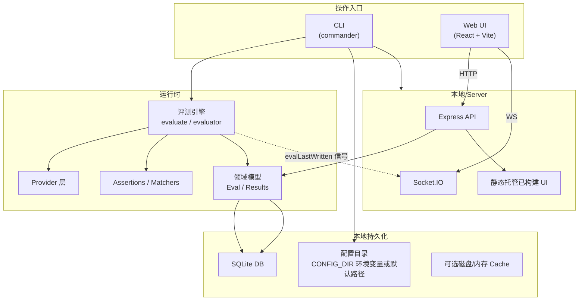
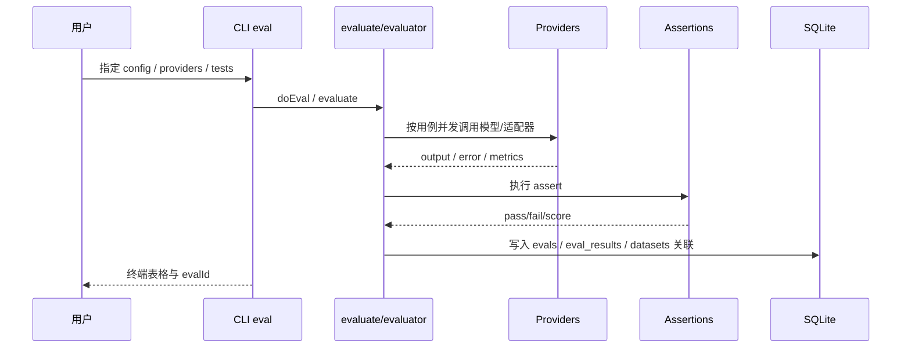
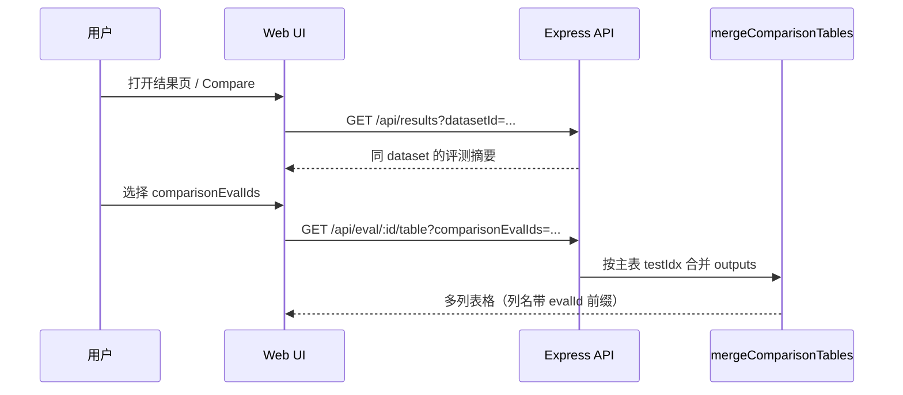

# AI Model Evaluation & Comparison Platform

**中文名称：AI 模型评测与结果对比平台**

基于配置驱动的本地 LLM 评测与结果分析工具：通过 YAML/CLI 定义 prompt、provider 与 assertions，批量执行评测，并将结果持久化后在 Web UI 中查看、筛选与并排对比。

> License: MIT  
> Runtime: Node.js `>= 22.22.0`（见根目录 `package.json` / `.nvmrc`）

---

## 1. Project Overview

本项目解决的是：**如何用可重复、可自动化的方式，评测与比较大模型在固定用例集上的输出质量**。

典型痛点包括：

- 手工试 prompt / 换模型难以留痕与回归
- 多模型、多 prompt 需要统一 assertions 与评分
- 需要本地查看历史评测，并在同类数据集上并排对比差异

本仓库提供：

- **CLI**：初始化配置、执行评测、查看结果、导入导出等
- **本地 HTTP Server + Web UI**：浏览评测矩阵、历史记录、对比视图等
- **本地 SQLite 持久化**：评测、结果行、dataset、prompts、traces 等
- **Provider 适配层**：对接多家模型 API，以及 `echo` / HTTP / 脚本类 provider，便于本地调试与 CI
- **Assertions / Matchers**：规则断言与模型打分等多种检查方式
- **Red team / Code scan / Model audit** 等扩展能力（源码与路由已实现，使用方式依赖对应子命令与配置）

评测默认在**本机**执行与存储；是否外呼模型 API 取决于你配置的 provider 与密钥。

---

## 2. Core Features

下列能力均可在源码中直接对应到实现（CLI `src/commands/*`、引擎 `src/evaluate.ts` / `src/evaluator`、UI `src/app`、API `src/server`）。

| 能力 | 说明 |
|------|------|
| 配置驱动评测 | 通过配置文件声明 `providers` / `prompts` / `tests` / `assert`，执行 `eval` |
| 多 Provider | 内置大量 provider 适配（OpenAI、Anthropic、Azure、Bedrock、Ollama、HTTP、echo 等，见 `src/providers`） |
| Assertions | 规则类（contains、regex、json、sql…）与模型评分类（llm-rubric、similar、factuality…），见 `src/assertions` |
| 结果矩阵 UI | Web 结果表、筛选、分页、导出相关能力（`src/app` + `/api/eval/:id/table`） |
| 评测对比 | UI 侧按 **同一 dataset** 过滤可选评测；服务端按 **`testIdx` 并排合并** outputs |
| 历史与数据集 | 评测列表、prompts、datasets、history 等页面与 API |
| 本地持久化 | SQLite（`drizzle-orm` + `@libsql/client`），库文件位于配置目录 |
| Red team | `redteam` 相关 CLI 与 `/api/redteam`、UI setup/report 页面 |
| 分享（可选） | `share` 命令与 `/api/results/share`（可用环境变量关闭） |
| 开发态热更新 | `view` Server 监视评测写入信号，经 Socket.IO 通知前端刷新 |
| 测试基线 | Vitest 单测 / 集成 / smoke；smoke 夹具可用 `echo` provider 无外呼跑通 |

**明确不是“已宣称但源码不存在”的能力：** 本 README 不把 optional peer 依赖或文档站功能写成默认安装即可用的核心路径。

---

## 3. System Architecture



### 逻辑分层（与目录对应）

| 层 | 主要位置 |
|----|----------|
| CLI 入口 | `src/entrypoint.ts`（发布）、`src/localEntrypoint.ts`（开发 `npm run local`）→ `src/main.ts` |
| 命令 | `src/commands/`（`eval`、`view`、`init`、`list`、`export`、`redteam`…） |
| 评测编排 | `src/evaluate.ts`、`src/evaluator/`、`src/node/doEval.ts` |
| Provider | `src/providers/` |
| Assertions | `src/assertions/`、`src/matchers/` |
| 持久化 | `src/database/`、`src/models/` |
| HTTP API | `src/server/server.ts`、`src/server/routes/*` |
| Web UI | `src/app/`（Vite 构建产物输出到 `dist/src/app`） |

## 4. Technology Stack

以下均为源码与 `package.json` / workspace 中**实际使用**的核心技术（不把未接线的 optional peer 写成必选栈）。

### 后端 / CLI

| 技术 | 用途 | 依据 |
|------|------|------|
| Node.js `>=22.22.0` | 运行时 | `package.json` `engines`、`.nvmrc` |
| TypeScript | 主语言 | 源码与 `tsc` / `tsdown` 构建 |
| Commander | CLI 解析 | `dependencies.commander`、`src/commands/*` |
| Express 5 | HTTP API | `src/server/server.ts` |
| Socket.IO | 评测更新推送 | `startServer` 内 `SocketIOServer` |
| Zod | 请求/配置校验 | API schemas、命令 option 解析 |
| Drizzle ORM | SQL 访问层 | `src/database/` |
| `@libsql/client` | SQLite 驱动 | `getDb()` |
| `better-sqlite3` | 依赖树中存在；库访问主路径为 libsql | `package.json` |
| Nunjucks | Prompt 模板 | `dependencies.nunjucks` |
| Winston | 日志 | `dependencies.winston` |
| Vitest | 测试 | 根与 `src/app` scripts |

### 前端

| 技术 | 用途 | 依据 |
|------|------|------|
| React 19 | UI | `src/app/package.json` |
| Vite 8 | 开发与构建 | `src/app/vite.config.ts` |
| React Router | 路由 | `src/app/src/routes.tsx` |
| Zustand / TanStack Query | 状态与请求 | app 依赖 |
| Tailwind CSS + Radix UI | 样式与组件 | app 依赖 |
| Chart.js / Recharts | 图表 | app 依赖 |

### 说明

- 文档站点 `site/` 为独立 workspace（Docusaurus），**不是**评测运行时的必要条件。
- 各云厂商 SDK 多以 **optional / peer** 形式存在：只有配置了对应 provider 时才需要额外安装与密钥。

---

## 5. Core Workflows

### 5.1 评测执行



要点（源码行为）：

- 默认并发见 `DEFAULT_MAX_CONCURRENCY`（当前为 4），可用 `-j` 调整
- `testIdx` 在编排阶段按展开后的结果行递增分配，并写入 `eval_results.test_idx`
- `datasetId` 来自配置 `tests` 快照的哈希，并关联到 `datasets` / `evals_to_datasets`

### 5.2 查看与对比



要点：

- **UI**：对比选择器按同一 `datasetId` 过滤
- **服务端**：对比接口**不**强制校验双方 `datasetId` 一致；只检查对比 eval 是否存在
- **合并键**：`testIdx`（不是用例内容指纹）

---

## 6. Project Structure

```text
.
├── package.json              # 根包、scripts、engines、依赖
├── package-lock.json         # 锁定依赖
├── .nvmrc                    # 推荐 Node 版本
├── src/
│   ├── entrypoint.ts         # 发布版 CLI 入口（含 Node 版本检查）
│   ├── localEntrypoint.ts    # 开发入口（npm run local）
│   ├── main.ts               # 注册全部子命令
│   ├── evaluate.ts           # 评测入口编排
│   ├── commands/             # eval / view / init / redteam / ...
│   ├── providers/            # 模型与自定义 provider
│   ├── assertions/           # 断言实现
│   ├── matchers/             # 相似度/评分匹配器
│   ├── models/               # Eval 等领域模型
│   ├── database/             # Drizzle schema / DB 连接
│   ├── server/               # Express + routes + Socket.IO
│   ├── app/                  # React Web UI（Vite workspace）
│   ├── redteam/              # 红队相关
│   ├── codeScan/             # 代码扫描相关
│   └── util/                 # 配置、导出、对比合并等工具
├── test/                     # Vitest 等测试与 smoke fixtures
├── site/                     # 文档站点 workspace（可选）
├── docs/                     # 工程文档（本 README 位于此处）
└── dist/                     # 构建输出（安装/构建后生成）
```

## 7. Installation & Setup

### 7.1 环境要求

- **Node.js `>= 22.22.0`**（已在 `package.json#engines` 与 `.nvmrc` 核实）
- npm（随 Node 提供；本仓库使用 `package-lock.json`）
- 如需原生模块完整安装：Windows 上可能需要可用的 C++ 构建工具链（否则部分依赖安装可能失败）
- 调用真实模型时：对应 provider 的 API Key

### 7.2 从源码安装

在仓库根目录：

```bash
# 建议先切换到 Node 22.22+
node -v

npm install
```

开发时常用：

```bash
# 不经过 dist，直接跑 CLI
npm run local -- --help

# 并行启动 API（tsx watch）与前端 Vite
npm run dev

# 仅前端
npm run dev:app

# 仅服务
npm run dev:server
```

完整构建（CLI + 服务端打包 + UI）：

```bash
npm run build
```

构建后可通过 `package.json` 的 `bin` 字段指向的 `dist/src/entrypoint.js` 使用 CLI（具体命令名以该字段为准）。

### 7.3 最小可跑通（无外呼模型）

可使用内置 **`echo` provider**（回显 prompt，便于验证配置与断言），例如：

```yaml
description: "local smoke"
providers:
  - echo
prompts:
  - "Hello {{name}}"
tests:
  - vars:
      name: world
    assert:
      - type: contains
        value: "world"
```

```bash
npm run local -- eval -c path/to/config.yaml --no-share --no-cache
npm run local -- view -p 15500 -n
```

浏览器访问：`http://localhost:15500`（端口可用 `API_PORT` 或 `view -p` 覆盖）。

### 7.4 测试

```bash
npm test
npm run test:smoke
npm run test:app
```

---

## 8. Configuration

### 8.1 评测配置文件

常用字段（与 smoke / 评测路径一致）：

| 字段 | 含义 |
|------|------|
| `description` | 评测描述 |
| `providers` | 模型或适配器列表（如 `echo`、`openai:...`） |
| `prompts` | Prompt 模板（支持变量） |
| `tests` | 用例：`vars`、`assert` 等 |
| `defaultTest` | 默认用例选项 / 断言 |
| `evaluateOptions` | 并发、进度条等 |

CLI 也可用 `-c/--config`、`-r/--providers`、`-p/--prompts`、`-t/--tests` 等覆盖（见 `src/commands/eval.ts`）。

### 8.2 配置与数据目录

- 环境变量 **`PROMPTFOO_CONFIG_DIR`**（源码遗留键名）：覆盖本地配置/数据库目录
- 未设置时：默认使用用户主目录下的隐藏配置目录（源码 `getConfigDirectoryPath()`）
- 数据库文件：该目录下的 SQLite 文件（`getDbPath()`）
- `view [directory]`：可将配置目录指到给定路径（`setConfigDirectoryPath`）

### 8.3 常用环境变量（摘自 `src/envars.ts` / `src/constants.ts`）

> 下列以 `PROMPTFOO_` 开头的键名为**当前源码中的真实环境变量标识**（遗留命名），运行时必须使用这些字面量；不代表产品品牌。

| 变量 | 作用 |
|------|------|
| `PROMPTFOO_CONFIG_DIR` | 配置与 DB 根目录 |
| `API_PORT` | 默认 HTTP 端口（默认 **15500**） |
| `PROMPTFOO_DISABLE_SHARING` | 禁用分享相关行为 |
| `PROMPTFOO_DISABLE_TELEMETRY` | 禁用遥测 |
| `PROMPTFOO_CACHE_ENABLED` / `PROMPTFOO_CACHE_PATH` | 缓存开关与路径 |
| `PROMPTFOO_EVAL_TIMEOUT_MS` | 单用例超时 |
| `PROMPTFOO_MAX_EVAL_TIME_MS` | 整次评测最长耗时 |
| `IS_TESTING` | 测试时使用内存库等行为 |
| `OPENAI_API_KEY` / `ANTHROPIC_API_KEY` / … | 各 provider 密钥（按需） |
| `LOG_LEVEL` | `error` \| `warn` \| `info` \| `debug` |

前端开发时，Vite 将 `API_PORT`（默认 15500）用于组装远程 API 基址（`src/app/vite.config.ts`）；前端开发服务器端口为 **3000**。

## 9. Usage Guide

### 9.1 CLI 常用命令

（开发态以 `npm run local -- <cmd>` 为例；构建后使用 `bin` 入口。）

| 命令 | 作用 |
|------|------|
| `init` | 初始化示例/配置 |
| `eval` | 执行评测 |
| `view` | 启动本地 UI Server |
| `list` / `show` | 列出或查看评测等对象 |
| `export` / `import` | 导入导出 |
| `share` | 生成分享链接（可禁用） |
| `validate` | 校验配置 |
| `redteam …` | 红队相关子命令 |
| `generate …` | 生成数据集/断言等 |
| `mcp` | MCP 相关入口 |

`eval` 常用选项（已在 `src/commands/eval.ts` 核实）：

- `-c, --config`、`-r, --providers`、`-p, --prompts`、`-t, --tests`
- `-j, --max-concurrency`、`--repeat`、`--delay`、`--no-cache`
- `-o, --output`、`--share` / `--no-share`、`--no-write`
- 各类 `--filter-*`、`--resume`、`-w, --watch`

### 9.2 Web UI 主要路由

（`src/app/src/routes.tsx`）

| 路径 | 页面 |
|------|------|
| `/eval`、`/eval/:evalId` | 评测结果 |
| `/evals` | 评测列表 |
| `/datasets` | 数据集 |
| `/prompts` | Prompts |
| `/history` | 历史 |
| `/setup` | 评测创建向导 |
| `/redteam/setup`、`/reports` | 红队与报告 |
| `/model-audit*` | 模型审计相关 |
| `/media` | 媒体库 |

### 9.3 结果对比用法建议

1. 对**同一 `tests` 配置**跑出多次 eval（保证 `datasetId` 一致）。
2. 在结果页使用 Compare，仅从同 dataset 列表选择。
3. 避免绕过 UI、直接对**不同 dataset** 调用对比 API（见「Known Limitations」）。

---

## 10. API Overview

本地 Server 由 `createApp()` / `startServer()` 创建。前缀与挂载关系如下。

### 10.1 根级路由（`src/server/server.ts`）

| 方法 | 路径 | 说明 |
|------|------|------|
| GET | `/health` | 健康检查 |
| GET | `/api/remote-health` | 远程能力健康状态 |
| GET | `/api/results` | 评测摘要列表；可选 `datasetId`、`type` |
| GET | `/api/results/:id` | 单条结果 |
| GET | `/api/prompts` | Prompt 汇总 |
| GET | `/api/prompts/:sha256hash` | 按 hash 查 prompts |
| GET | `/api/datasets` | 数据集列表 |
| GET | `/api/history` | 历史评测 |
| POST | `/api/results/share` | 创建分享 URL |
| GET | `/api/results/share/check-domain` | 分享域名检查 |
| POST | `/api/dataset/generate` | 合成测试数据 |
| POST | `/api/telemetry` | 遥测事件 |

### 10.2 路由挂载

| 挂载点 | 模块 |
|--------|------|
| `/api/eval` | `routes/eval.ts` |
| `/api/media` | media |
| `/api/blobs` | blobs |
| `/api/providers` | providers |
| `/api/redteam` | redteam |
| `/api/user` | user |
| `/api/configs` | configs |
| `/api/model-audit` | modelAudit |
| `/api/traces` | traces |
| `/api/version` | version |

### 10.3 `/api/eval` 要点（`routes/eval.ts`）

| 方法 | 路径 | 说明 |
|------|------|------|
| GET | `/:id/table` | 结果表；支持 `comparisonEvalIds` 并排对比 |
| GET | `/:id/metadata-keys` / `metadata-values` | 元数据浏览 |
| POST | `/` | 创建/写入评测 |
| POST | `/job`、GET `/job/:id` | 异步任务 |
| POST | `/replay` | 重放 |
| POST | `/:id/results` | 追加结果 |
| POST | `/:id/copy` | 复制 |
| PATCH | `/:id`、`/:id/author` | 更新 |
| DELETE | `/:id`、`/` | 删除 |

对比合并实现：`src/util/eval/evalTableUtils.ts` → `mergeComparisonTables`。

## 11. Known Limitations

以下为**当前实现中的真实限制/缺陷**，请勿理解为已修复。

### 11.1 评测对比：对齐语义偏弱

| 点 | 现状 |
|----|------|
| UI 保护 | Compare 对话框按 `datasetId` 过滤可选评测 |
| 服务端 | `GET /api/eval/:id/table?comparisonEvalIds=` **不校验**主/对比评测 `datasetId` 是否一致 |
| 合并键 | 仅按结果行 **`testIdx`** 拼接 outputs；**不**按 `testCase` / vars 内容指纹匹配 |
| 失败语义 | 对比 eval 不存在 → 404；dataset 不一致 → 仍可能 200 并静默错行 |
| `datasetId` | `sha256(JSON.stringify(config.tests))`：顺序变化通常产生新 id；同 id 也不保证所有展开边界下矩阵不变 |

影响：幸福路径（同配置重复跑 + UI 选择）可用；直接调 API、错误 dataset、或展开矩阵漂移时，可能出现**看起来整齐但实际错配**的对比表（UI 左侧 vars 始终来自主评测）。

### 11.2 平台与运维

- **Node 版本严格**：低于 `22.22.0` 会在入口直接退出。
- **原生依赖**：完整 `npm install` 在部分 Windows 环境可能因缺少 C++ 工具链失败。
- **默认数据目录**：若未设置 `PROMPTFOO_CONFIG_DIR`，数据写入用户主目录下默认配置路径；测试/并行任务务必隔离，避免污染个人库。
- **分享与遥测**：默认代码路径包含相关能力，生产或隐私场景需显式用环境变量关闭。
- **对比 CSV**：与 UI 共用合并逻辑，因此对比错配风险同样存在于导出。

### 11.3 功能边界

- 真实模型评测依赖外部 API 可用性、配额与费用。
- Red team / 远程生成等能力可能依赖网络与远端服务；可用 `PROMPTFOO_DISABLE_REMOTE_GENERATION` 等开关限制。
- UI 开发服务器（3000）与 API（默认 15500）分离；生产 `view` 由同一 Server 托管构建后的静态资源。

---

## 12. Roadmap

**已实现（现状）：** 配置化评测、多 provider、断言体系、本地 SQLite、Web 结果浏览、同 dataset UI 对比、red team/model audit/code scan 等模块、较完整测试脚本。

**建议规划（未实现 / 未合入，仅方向）：**

1. **对比正确性加固**：服务端强制校验 `datasetId`（或行级用例指纹）；不一致时明确 4xx/告警，而非静默并排。
2. **更稳定的用例身份**：在 `testIdx` 之外引入跨 eval 稳定 ID，支持改序/增删后的安全对比。
3. **验收样例与回归**：固化 mock provider 下的同 dataset / 改序 / 跨 dataset API 用例。
4. **安装体验**：降低 Windows 原生模块安装门槛；明确最小依赖安装配置文件（若未来拆分 optional providers）。
5. **品牌与路径清理**（若做独立发行）：CLI 命令名、默认配置目录名、环境变量前缀与包名的统一重命名迁移方案。

---

## 附录：数据库核心表（摘要）

来源：`src/database/tables.ts`

| 表 | 作用 |
|----|------|
| `evals` | 评测主记录（config、prompts 摘要等） |
| `eval_results` | 行级结果（含 `test_idx`、`test_case`、输出与评分） |
| `datasets` / `evals_to_datasets` | 测试集快照与关联 |
| `prompts` / `evals_to_prompts` | Prompt 去重与关联 |
| `tags` / `evals_to_tags` | 标签 |
| `blob_assets` / `blob_references` | 多媒体 blob |
| `configs` | 命名配置存储 |
| `model_audits` | 模型审计结果 |
| `traces` / `spans` | 追踪数据 |

---

## 附录：快速对照

| 问题 | 答案 |
|------|------|
| 项目是什么？ | 本地优先的 AI 模型评测与结果对比平台（CLI + Web + SQLite） |
| 解决什么？ | 可重复评测、断言化验收、历史回顾与并排对比 |
| 怎么跑？ | Node 22.22+ → `npm install` → `npm run local -- eval` → `npm run local -- view` |
| 最大已知坑？ | 对比合并只认 `testIdx`，服务端不强制同 dataset |
