# AI Model Evaluation & Comparison Platform

# 技术学习手册（源码级）

> 用途：个人源码学习、架构理解、技术面试准备  
> 原则：只读源码分析；路径 / 函数名 / 关键行号均以仓库为准  
> 项目对外名称：AI Model Evaluation & Comparison Platform（中文：AI 模型评测与结果对比平台）  
> 说明：下文中的 `PROMPTFOO_*` 等标识是**源码遗留环境变量键名**，不等于产品品牌宣传。

---

## 目录

1. 项目整体认知  
2. 技术栈与第三方依赖  
3. 项目目录与源码地图  
4. 系统架构  
5. 核心功能逐一拆解  
6. 重点专题：评测结果对比机制  
7. 数据库与数据流  
8. API 接口手册  
9. 测试体系  
10. 源码学习路线  
11. 面试知识库  

---

## 1. 项目整体认知

### 1.1 项目定位

这是一个**本地优先**的 LLM 评测与结果分析平台：

- 用 YAML/JSON 配置描述 `providers` / `prompts` / `tests` / `assert`
- CLI 批量执行评测，结果写入本机 SQLite
- 本地 Express Server + React Web UI 浏览结果表、筛选、导出、**并排对比**
- 另有 redteam、model-audit、code-scan、MCP 等扩展能力（源码已存在）

**不是**纯云托管 SaaS 客户端；远程分享/生成是可开关的附加能力。

### 1.2 业务背景

解决「换模型 / 改 prompt 后缺乏可重复证据」的问题：

1. 固定用例集 → 跑多轮评测  
2. Assertions 给出 pass/fail/score  
3. 历史可追溯；同类 dataset 下对比两轮输出差异  

### 1.3 核心用户

| 角色 | 典型操作 |
|------|----------|
| 应用开发者 | `eval` 回归 prompt/模型 |
| 质量 / Eval 工程师 | 设计 assertions、对比基线 |
| 安全工程师 | redteam / model-audit |
| 平台二次开发者 | 扩展 provider、改对比契约 |

### 1.4 主要业务流程（概览）

```text
写配置 → CLI/Web 触发 evaluate → Provider 调用 → Assertions
  → Eval / eval_results / datasets 落库 → view UI / API 读表
  →（可选）Compare：选同 dataset 的另一 eval → mergeComparisonTables
```

### 1.5 总体架构（Mermaid）

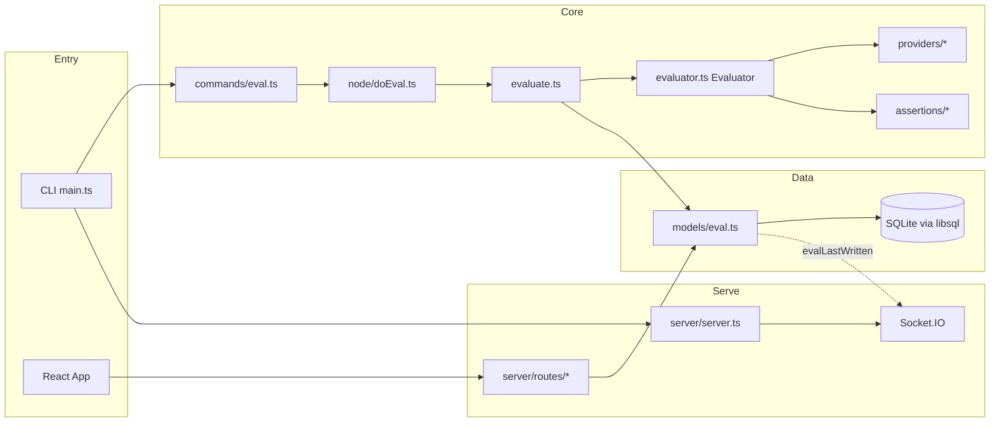

### 1.6 前后端关系

| 开发态 | 生产 / `view` |
|--------|----------------|
| Vite `:3000` + `dev:server`（默认 `API_PORT=15500`） | 同一 Express 托管 `dist/src/app` 静态资源并提供 `/api/*` |
| 前端通过 `VITE_PUBLIC_PROMPTFOO_REMOTE_API_BASE_URL` 指到 API | 同源访问 API |

### 1.7 数据库关系（概念）

- `evals` 1—N `eval_results`（行键含 `test_idx` + `prompt_idx`）  
- `evals` N—M `datasets`（经 `evals_to_datasets`）  
- `datasetId = sha256(JSON.stringify(config.tests||[]))`（`Eval.create`）

### 1.8 核心模块依赖（自上而下）

`commands` → `node/doEval` / `evaluate` → `evaluator` → `providers` + `assertions` → `models/eval` → `database`；  
`server/routes` 侧读 `Eval` 并调用 `evalTableUtils.mergeComparisonTables`。

---

## 2. 技术栈与第三方依赖

> 版本取自根/`src/app` 的 `package.json`（semver 范围）。Lock 文件存在，精确解析以 `package-lock.json` 为准；下列用途均在源码中核实。

### 2.1 后端 / CLI 直接依赖（核心）

| 名称与版本 | 用途 | 使用位置 | 使用方式 | 设计原因 | 面试考点 |
|------------|------|----------|----------|----------|----------|
| Node `>=22.22.0` | 运行时 | `entrypoint.ts`、`.nvmrc` | engines 检查后 import `main` | 依赖现代 JS 特性 | 为何入口单独做版本门禁 |
| TypeScript | 类型与构建 | 全仓 | `tsc` / `tsdown` | 大型评测引擎可维护性 | any 与契约边界 |
| `commander` ^15 | CLI | `src/commands/*` | `.command('eval').option(...)` | 子命令拆分 | option source 与配置优先级 |
| `express` ^5.2.1 | HTTP | `src/server/server.ts` | `createApp()`、`Router` | 本地 view 一体服务 | Express 5 路由差异 |
| `socket.io` ^4.8.4 | 推送 | `startServer` | `io.emit('update')` | 评测写入后热刷新 | WS vs SSE |
| `zod` ^4.3.6 | 校验 | `types/api/*`、`routes/eval.ts` | `safeParse` / `parse` | API 契约 | coerce 与 passthrough |
| `drizzle-orm` ^0.45.3 | ORM | `database/`、`models/eval.ts` | `db.insert/select`、`sql\`\`` | schema as code | SQL 注入防护 |
| `@libsql/client` ^0.18.0 | SQLite 驱动 | `database/index.ts` `getDb()` | `createClient` + drizzle | 本机嵌入式存储 | WAL / busy_timeout |
| `better-sqlite3` ^13 | 依赖声明存在 | package.json | **主路径是 libsql**；勿当作当前读写主入口 | 历史/兼容候选 | 直接依赖≠主路径 |
| `nunjucks` ^3.2.4 | 模板 | `util/templates`、evaluator | `renderPrompt` | prompt 变量插值 | sandboxed env |
| `winston` ^3.19 | 日志 | `logger.ts` | logger.info/error | 可级联 LOG_LEVEL | 结构化日志 |
| `async` ^3.2.6 | 并发限流 | `evaluator.ts` | `async.forEachOfLimit` | 控制 provider 并发 | 与 RateLimitRegistry 关系 |
| `openai` ^7.20.0 | OpenAI 适配 | `providers/openai/*` | SDK client | 主流模型 | Responses vs Chat |
| `@anthropic-ai/sdk` 0.131.0 | Anthropic | `providers/anthropic` | SDK | 主流模型 | messages API |
| `csv-stringify` / `csv-parse` | CSV | `evalTableUtils.ts` | `csvStringify` | 导出统一格式 | CWE-1236 formula |
| `compression` / `cors` | HTTP 中间件 | `server.ts` | `app.use` | 本地开发便利 | CSRF 另见 middleware |

### 2.2 前端依赖（`src/app/package.json`）

| 名称与版本 | 用途 | 使用位置 | 使用方式 | 设计原因 | 面试考点 |
|------------|------|----------|----------|----------|----------|
| `react` ^19.3 | UI | `pages/**` | 组件树 | 现代 React | Compiler 插件 |
| `vite` ^8 | 构建 | `vite.config.ts` | `dev` / `build` → `dist/src/app` | 快速 HMR | define env |
| `react-router` ^8.4 | 路由 | `routes.tsx` | `createRoutesFromElements` | SPA | 嵌套路由 |
| `zustand` ^5 | 状态 | `pages/eval/components/store.ts` | `create` store | 结果页大状态 | 与 React Query 分工 |
| `@tanstack/react-query` ^5.91 | 服务端缓存 | hooks / pages | `useQuery` | 列表类请求 | staleTime |
| `@tanstack/react-table` ^8 | 表 | evals/results | table API | 大数据表格 | 虚拟滚动 |
| `@tanstack/react-virtual` | 虚拟列表 | 结果表相关 | virtualizer | 大结果集 | overscan |
| `tailwindcss` ^4.2 | 样式 | app CSS | utility | 快速 UI | v4 postcss |
| `@radix-ui/react-*` | 无样式组件 | Dialog/Select… | Radix primitives | a11y | Controlled dialog |
| `recharts` / `chart.js` | 图表 | 报告/统计页 | Chart 组件 | 可视化 | 大数据抽样 |
| `socket.io-client` | 订阅更新 | app 侧连接 view server | `io(...)` | 与后端配套 | reconnect |
| `js-yaml` / `csv-*` | 配置/导出辅助 | setup 等页 | parse/stringify | 浏览器内配置 | schema |
| `vitest` + `jsdom` | 前端测试 | `*.test.tsx` | vitest | 组件单测 | forks pool |

### 2.3 间接依赖 / 已装但勿夸大

| 类型 | 例子 | 说明 |
|------|------|------|
| 间接 | `undici`、`ws` | HTTP/WS 底层，经直接依赖引入 |
| optional/peer | 大量云 SDK、`playwright` | 仅特定 provider 路径需要 |
| workspace | `site/` Docusaurus | 文档站，非评测运行时必需 |
| 已声明但非 DB 主路径 | `better-sqlite3` | 见上 |

### 2.4 HTTP 客户端说明

前端结果页大量用 **原生 `fetch` + URLSearchParams**（如 `store.ts` 拼 `comparisonEvalIds`），不是以 axios 为核心。

---

## 3. 项目目录与源码地图

### 3.1 核心目录树（精简）

```text
src/
  entrypoint.ts / localEntrypoint.ts / main.ts
  commands/          # CLI 子命令
  node/              # doEval 等 Node 层
  evaluate.ts        # evaluate() 编排入口
  evaluator.ts       # Evaluator 引擎（巨文件）
  providers/         # 模型适配
  assertions/        # 断言
  matchers/          # 评分匹配
  models/eval.ts     # Eval 领域模型
  database/          # drizzle schema + getDb
  server/            # Express + Socket.IO
  app/src/           # React UI
  util/eval/         # CSV/mergeComparisonTables
  redteam/ codeScan/ tracing/ ...
test/                # vitest / smoke
docs/                # 本手册所在处
```

### 3.2 入口文件

| 入口 | 路径 | 作用 |
|------|------|------|
| 发布 CLI | `src/entrypoint.ts` | Node 版本检查 → `main.js` |
| 开发 CLI | `src/localEntrypoint.ts` | `npm run local` → `main.ts` |
| 命令注册 | `src/main.ts` | 挂载 eval/view/redteam… |
| HTTP | `src/server/server.ts` `createApp`/`startServer` |
| UI | `src/app/src/routes.tsx` |

### 3.3 源码导航表（评测主链 + 对比）

| 关注点 | 路径 | 符号 |
|--------|------|------|
| eval CLI | `src/commands/eval.ts` | `evalCommand` |
| 执行 | `src/node/doEval.ts` | `doEval` |
| 编排 | `src/evaluate.ts` | `evaluate` / `evaluateWithEnv` |
| 引擎 | `src/evaluator.ts` | `Evaluator`、`runEval`、`appendRunEvalOptionsForTestCase` |
| 断言分发 | `src/assertions/index.ts` | `runAssertions` |
| Provider 加载 | `src/providers/index.ts` | `loadApiProviders` |
| 持久化 | `src/models/eval.ts` | `Eval.create`、`getTablePage`、`getEvalSummaries` |
| 对比合并 | `src/util/eval/evalTableUtils.ts` | `mergeComparisonTables`、`generateEvalCsv` |
| Table API | `src/server/routes/eval.ts` | `GET /:id/table` ~L304 |
| 结果页 UI | `src/app/.../ResultsView.tsx` | Compare / `handleComparisonEvalSelected` |
| 对比对话框 | `.../EvalSelectorDialog.tsx` | `filterByDatasetId` |
| 评测列表 | `.../EvalsTable.tsx` | `?datasetId=` |
| 前端 store | `.../eval/components/store.ts` | `comparisonEvalIds` append |

---

## 4. 系统架构

### 4.1 前端架构

- **路由层**：`routes.tsx` 挂 `/eval`、`/evals`、`/datasets`、`/redteam/*` 等  
- **页面态**：Zustand（结果表分页、comparison IDs、filter）  
- **请求态**：TanStack Query（列表类）+ 直接 fetch（表格热点路径）  
- **实时**：Socket.IO 收 `init`/`update` 后刷新当前 eval  

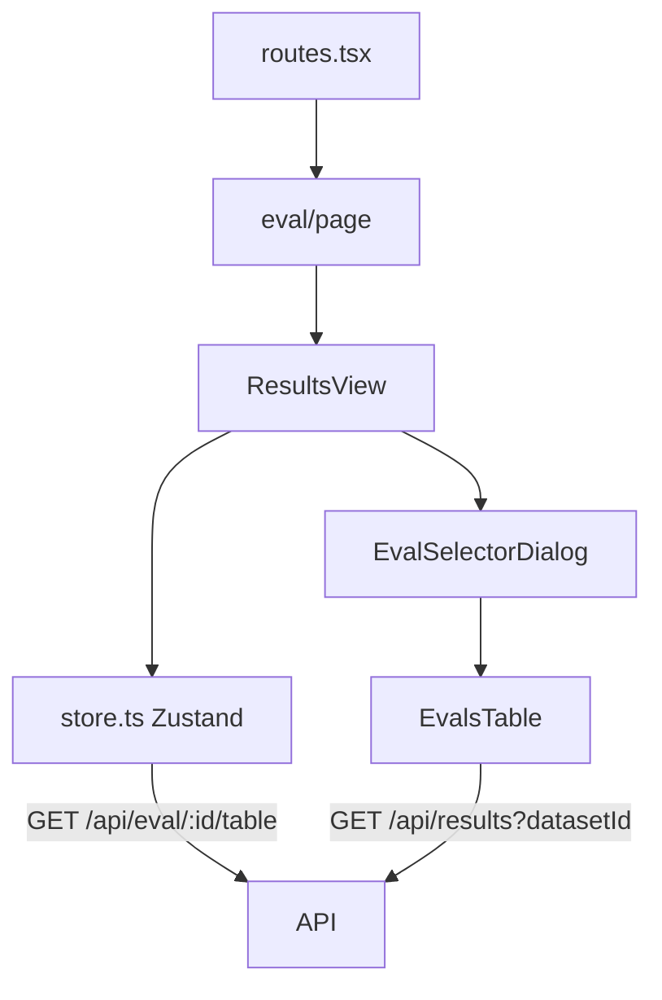

### 4.2 后端架构

- `createApp`：CORS、CSRF、compression、JSON limit、静态资源、SPA fallback  
- 业务 Router：`/api/eval`、`/api/results`、`/api/datasets`…  
- `startServer`：迁移 DB、Socket.IO、信号文件监视器  

### 4.3 API 通信架构

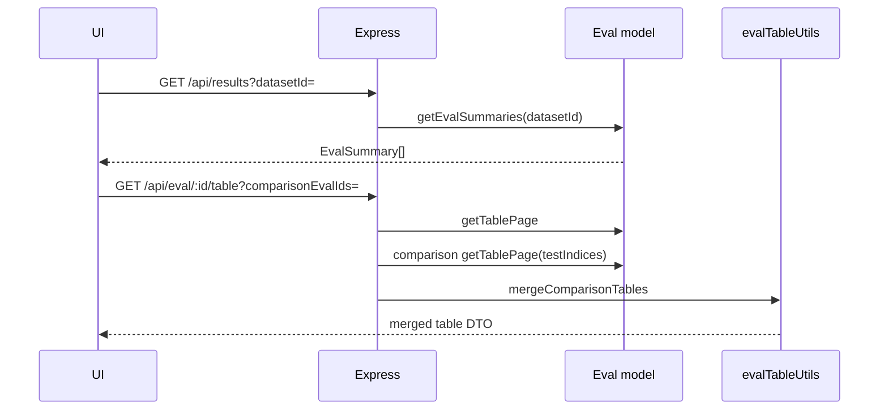

### 4.4 数据库架构

见第 7 章 ER；连接：`getDb()` → libsql file URL 或测试内存库。

### 4.5 AI 评测执行架构

```mermaid
flowchart TB
  evaluate --> buildLivePromptColumns
  evaluate --> buildRunEvalOptions
  buildRunEvalOptions --> appendRunEvalOptionsForTestCase
  appendRunEvalOptionsForTestCase --> generateVarCombinations
  appendRunEvalOptionsForTestCase --> nextTestIdx
  Evaluator --> runEval
  runEval --> callProvider
  runEval --> runAssertions
  Evaluator --> Eval.addResult / persist
```

关键事实：`testIdx` 在 `appendRunEvalOptionsForTestCase` 中按（repeat × varCombination）递增（`evaluator.ts` ~3019–3028、`appendRunEvalOptionsForTestCase`）。

### 4.6 结果存储架构

V4：`evals` 主表 + `eval_results` 行表；展示表由 `getTablePage` 动态组装。  
V3 遗留：结果表塞在 `evals.results` JSON（`Eval.version()`）。

### 4.7 评测结果对比架构

- UI：同 dataset 过滤（软约束）  
- API：存在性检查 + **按 testIdx 合并**（硬逻辑）  
- CSV：`generateEvalCsv` 复用同一 merge  

详解见第 6 章。

## 5. 核心功能逐一拆解

> 每个功能按：用途 → 入口 → 调用链 → 路径/符号 → 数据结构 → 原理 → 协作 → 流程图 → 面试点。

### 5.1 项目初始化与配置加载

1. **用途**：加载统一配置（`UnifiedConfig`），解析 prompts/providers/tests。  
2. **入口**：`init` 命令；`eval -c`；默认 `promptfooconfig.yaml`（eval option 文案）。  
3. **调用链**：`evalCommand` → `doEval` → 配置读取 → `evaluate` / `Eval.create`。  
4. **路径**：`src/commands/eval.ts`、`src/commands/init.ts`、`src/util/config/*`、`src/evaluate.ts`。  
5. **输入输出**：YAML → `Partial<UnifiedConfig>`；输出含 rendered prompts。  
6. **原理**：配置与运行时 suite 可能分离：哈希 dataset 用的是序列化 config.tests，执行用 `readTests` 展开后的 suite（对比专题边界）。  
7. **协作**：`cliState.basePath`、env overlays（`envars.ts`）。  

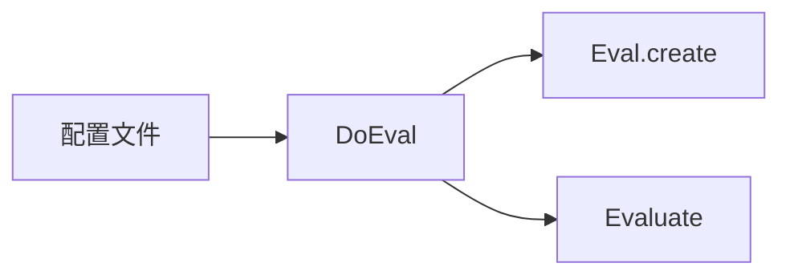

**面试**：配置优先级 CLI vs file vs env；为何 dataset 哈希不基于展开矩阵。

### 5.2 数据集管理

1. **用途**：以 `tests` 快照标识「同一套评测数据」。  
2. **入口**：隐式——`Eval.create`；显式——UI `/datasets`、`GET /api/datasets`。  
3. **调用链**：`sha256(JSON.stringify(config.tests||[]))` → `datasetsTable` upsert → `evals_to_datasets`。  
4. **路径**：`src/models/eval.ts` L501–587；`tables.ts` datasets；`server.ts` `/api/datasets`。  
5. **结构**：`{ id, tests, createdAt }`；关联表 `(evalId, datasetId)`。  
6. **原理**：内容相等（含顺序）→ 同 id；顺序变化 → 新 id。  
7. **对比协作**：UI 用 datasetId 过滤；API table **不用**它做门禁。  

### 5.3 评测配置管理

1. **用途**：命名保存 redteam/eval 配置。  
2. **入口**：`/api/configs`、`configsTable`、UI setup。  
3. **路径**：`src/server/routes/configs.ts`、`tables.ts` `configsTable`。  

### 5.4 评测任务创建（Web Job）

1. **用途**：UI 异步启动评测。  
2. **入口**：`POST /api/eval/job`。  
3. **调用链**：`evalJobService.create` → `evaluateWithSource` → `complete/fail`；轮询 `GET /job/:id`。  
4. **路径**：`routes/eval.ts` L133–205；`services/evalJobService`。  
5. **注意**：Zod 校验后仍用 `req.body.providers` 保留嵌套 config（注释已写明原因）。  

### 5.5 评测任务执行（核心）

1. **用途**：对每个 (provider × prompt × expanded test) 调模型并断言。  
2. **入口**：CLI `eval` / Web job / 库 `evaluate()`。  
3. **调用链**：

```text
evalCommand → doEval → evaluate(testSuite, evalRecord, options)
  → Evaluator.evaluate
    → buildLivePromptColumns
    → buildRunEvalOptions → appendRunEvalOptionsForTestCase (分配 testIdx)
    → runEval / processEvalStepWithTimeout
      → callProviderForRunEval → runAssertions
    → Eval.addResult / persist
    → (可选) select-best / max-score 比较断言
```

4. **路径**：`evaluator.ts`（`Evaluator` 类、`runEval`、`appendRunEvalOptionsForTestCase`）；注释 L1751：`testIdx` = 结果表行号。  
5. **输入**：`TestSuite` + `InternalEvaluateOptions`（并发、repeat、cache…）。  
6. **输出**：`Eval` 持久化行 + prompt metrics。  
7. **原理**：串行/并发队列；RateLimitRegistry；可选 OTEL/trace。  

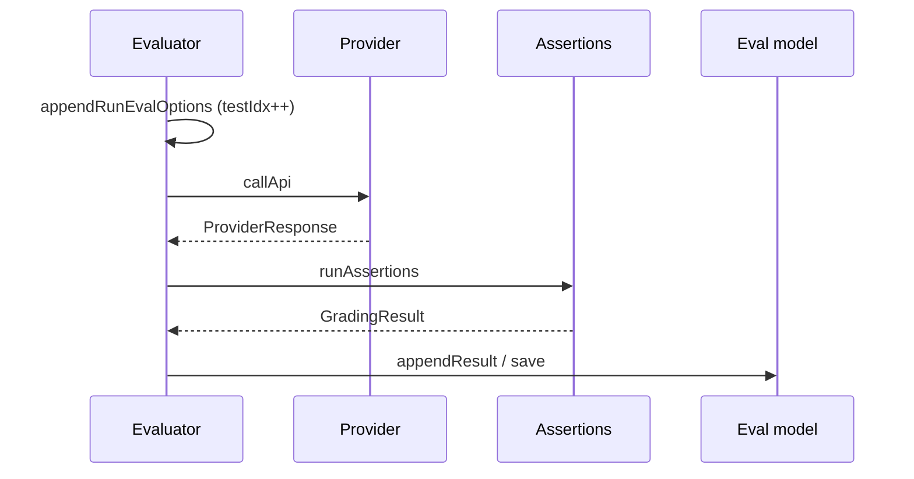

**面试**：为何 `testIdx` 不是原始 tests 下标；var 展开与 repeat 如何占多行。

### 5.6 模型调用

1. **用途**：统一 `ApiProvider.callApi`。  
2. **路径**：`providers/index.ts` `loadApiProviders`；各 `providers/<vendor>`；`echo` 用于本地 smoke。  
3. **结构**：`ProviderResponse { output, error, tokenUsage, cached, metadata }`。  
4. **协作**：`providerRegistry.withProvider`；delay/cache/backoff。  

### 5.7 结果处理

1. **用途**：transform、blob 抽取、grading、namedScores。  
2. **路径**：`transformRunEvalResponse`、`extractAndStoreBinaryData`、`applyGradingResult`。  
3. **状态**：`success` / `failureReason`（ASSERT vs ERROR）。  

### 5.8 结果存储

1. **用途**：可分页查询的评测历史。  
2. **路径**：`Eval.create` 事务；`EvalResult.createFromEvaluateResult`；`getTablePage` 聚合。  
3. **信号**：`notifyEvaluationChanged` → 文件系统信号 → Socket.IO（`server.ts`）。  

### 5.9 结果列表

1. **入口**：`/evals`、`GET /api/results`。  
2. **路径**：`getEvalSummaries`（`models/eval.ts` ~1850）；前端 `EvalsTable`。  
3. **参数**：`datasetId`、`type=redteam|eval`、`includeProviders`。  

### 5.10 结果详情

1. **入口**：`/eval/:evalId`。  
2. **调用**：`store.ts` → `GET /api/eval/:id/table?offset&limit&filterMode&search&filter`。  
3. **DTO**：`EvalTableDTO`（table/head/body、config、stats、filteredMetrics）。  

### 5.11 结果对比（摘要）

见第 6 章（本手册重点）。

### 5.12 错误处理

| 层 | 行为 | 位置 |
|----|------|------|
| Provider 抛错 | 行 ERROR，继续其它行 | `runEvalInternal` catch |
| Target 非瞬时 HTTP | 可中止整次扫描 | `abortIfTargetUnavailable` |
| API Zod 失败 | 400 + prettifyError | routes |
| Table 响应过大 | strip prompts / 413 | `sendEvalTableResponse` |
| 对比 eval 缺失 | 404 | `routes/eval.ts` L391–396 |

### 5.13 数据库交互

集中在 `getDb()` + drizzle；模型方法内写 SQL/`sql` 模板；对比只读 `getTablePage`。

---

## 6. 重点专题：评测结果对比机制

> 结合源码、`03-eval-comparison-learning.md` / validation 文档、以及 `tmp-comparison-run/api-compare-results.json` 的真实复现结果。  
> **未实施修复**——下列缺陷均为当前行为。

### 6.1 产品意图 vs 实现契约

| 层 | 意图/行为 |
|----|-----------|
| UI 文案 / 过滤器 | 「只有同 dataset 才能对比」 |
| 服务端 table API | 只要 comparison eval **存在**即可 merge |
| 合并算法 | 唯一对齐键 = **`testIdx`** |

### 6.2 前端选择流

**文件与行号：**

- `ResultsView.tsx`：`currentDatasetId` ~382–384；`handleComparisonEvalSelected` ~424–432；Dialog props `filterByDatasetId` / `focusedDatasetId` ~996–1003  
- `EvalSelectorDialog.tsx`：透传 props 到 `EvalsTable`  
- `EvalsTable.tsx`：请求 `?datasetId=` ~59–60；客户端再 filter ~99–100  
- `store.ts`：`comparisonEvalIds.forEach` → `url.searchParams.append('comparisonEvalIds', evalId)` ~634–635  

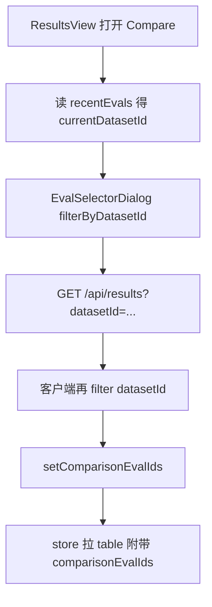

要点：路径参数是**主 eval id**；**不传** datasetId 给 table API。

### 6.3 API 与服务端合并

`GET /api/eval/:id/table`（`routes/eval.ts` ~304–418）：

1. Zod 解析 query（含 `comparisonEvalIds: string[]`）——**无 dataset 字段**  
2. `Eval.findById(id)`；404 if missing  
3. `getTablePage` 得主表；`indices = body.map(r => r.testIdx)`（~370）  
4. 对每个 comparisonId：`findById`；missing → 最终 404「Comparison eval not found」  
5. `comparisonEval.getTablePage({ testIndices: indices, filterMode:'all', ... })`  
6. `mergeComparisonTables(id, table, comparisonData)`  

`mergeComparisonTables`（`evalTableUtils.ts` ~627–661）：

- 表头 prompts 加 `[evalId]` 前缀  
- 对主表每一行：`compRow.testIdx === testIdx` 找对比行，**拼接 outputs**  
- vars 始终来自主表  
- 找不到对比行 → 该列空缺，**不报错**

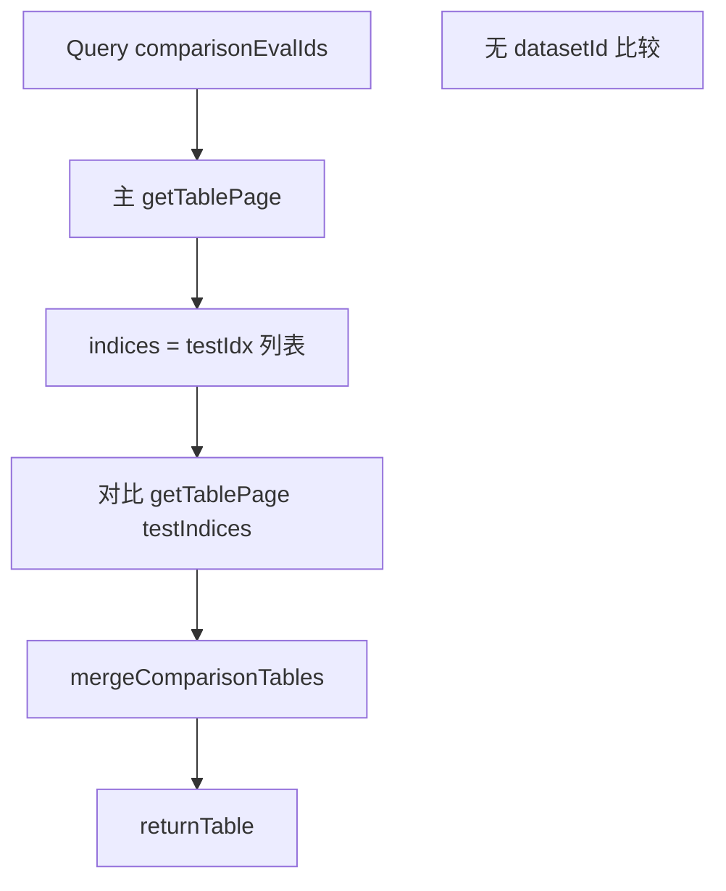

### 6.4 Eval ↔ Dataset

`Eval.create`（~501）：

```text
datasetId = sha256(JSON.stringify(config.tests || []))
```

写入 `datasets` + `evals_to_datasets`；`findById` 回填 `datasetId`；`getEvalSummaries(datasetId?)` 可过滤列表。

### 6.5 表格数据结构（概念）

```text
EvalTableDTO
  table.head.prompts[]   // 对比后长度 = 主prompts + 各对比prompts
  table.head.vars[]      // 主 eval vars 名
  table.body[]:
    testIdx
    vars[]               // 主侧变量值
    outputs[]            // 与 prompts 列对齐
  totalCount / filteredCount / config / id / stats...
```

### 6.6 真实复现（`tmp-comparison-run/api-compare-results.json`）

| 场景 | 实际结果 | 根本原因 | 影响 |
|------|----------|----------|------|
| 同 Dataset（run-A vs run-B） | status 200；testIdx 0/1/2 输出 alpha/beta/gamma 对齐 | 同展开顺序 + testIdx 一致 | 正常 |
| 测试用例顺序变化（reordered） | status 200；主侧 alpha 行对上对比侧 **gamma** 等 | 只按 testIdx；两边下标语义已变 | **静默错配** |
| 不同 Dataset | status 200；行上拼上 one/two，第三行对比列缺失 | 无服务端 dataset 校验；行数不同则空洞 | **结果不可靠** |
| 不存在的 Eval | status 404；`Comparison eval not found` | findById 失败分支 | 请求失败 |

复现 ID 示例：

- 同集：`eval-meT-...` / `eval-Wao-...`，dataset `66d522a7…`  
- 改序：`eval-uUL-...`，dataset `d5399d4b…`  
- 异集：`eval-szg-...`，dataset `6b4db713…`  

### 6.7 缺陷产生机制图

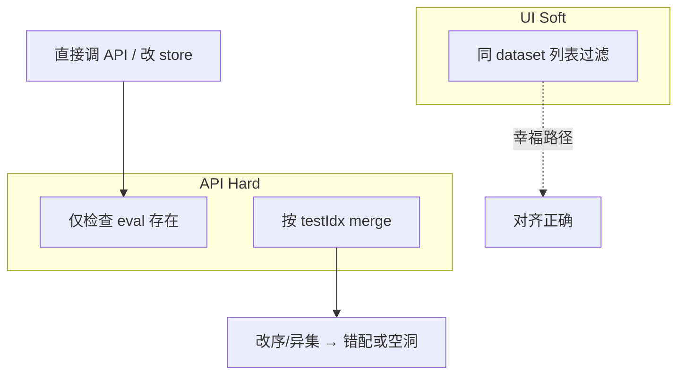

### 6.8 严格四分法

| 类别 | 内容 |
|------|------|
| 原始设计意图 | 同 dataset 的评测并排看差异 |
| 实际表现 | UI 软约束；API 宽松；对齐=testIdx |
| 缺陷原因 | 服务端缺 dataset 一致性；无 testCase 指纹 |
| 未实施修复 | 服务端校验 datasetId；可选行级指纹；回归单测——**文档不声称已修** |

### 6.9 面试追问

- 为何同 dataset 仍可能错位？（var 展开 / glob / repeat / 环境）  
- CSV 对比是否同洞？——是，`generateEvalCsv` 共用 merge。  
- 如何设计稳定用例 ID？（content hash / UUID 进 metadata）

---

## 7. 数据库与数据流

### 7.1 数据库类型与连接方式

| 项 | 事实（源码） |
|----|-------------|
| 类型 | SQLite（嵌入式文件库） |
| 主驱动 | `@libsql/client` + `drizzle-orm/libsql/node`（`src/database/index.ts` `getDb()`） |
| 文件路径 | `getDbPath()` → `{PROMPTFOO_CONFIG_DIR\|默认配置目录}/promptfoo.db` |
| 测试库 | `IS_TESTING=true` 时 `file::memory:?cache=shared` |
| 连接参数 | `concurrency: 1`；`PRAGMA foreign_keys=ON`；`busy_timeout`；生产尝试 `WAL` |
| 变更通知 | `getDbSignalPath()` → 同目录 `evalLastWritten`；`setupSignalWatcher` + Socket.IO |

> **注意**：根 `package.json` 声明了 `better-sqlite3`，但当前主读写路径是 **libsql**。面试/笔记勿把两者混为主入口。

### 7.2 核心表结构（字段含义）

源码：`src/database/tables.ts`。

| 表 | 关键字段 | 含义 |
|----|----------|------|
| `evals` | `id`, `createdAt`, `author`, `description`, `results`(JSON), `config`(JSON), `prompts`(JSON), `vars`(JSON), `runtimeOptions`, `isRedteam` | 评测主记录；V4 下 `results` 主要存 duration 等元数据；V3 兼容整表 JSON |
| `eval_results` | `evalId`, `promptIdx`, `testIdx`, `testCase`, `prompt`, `provider`, `response`, `error`, `failureReason`, `success`, `score`, `gradingResult`, `namedScores`, `metadata`, `latencyMs`, `cost` | 展开后每一格结果；**对比对齐键是 `test_idx`** |
| `datasets` | `id`, `tests`(JSON), `createdAt` | `tests` 快照；`id = sha256(JSON.stringify(config.tests\|\|[]))` |
| `evals_to_datasets` | `(evalId, datasetId)` PK | Eval ↔ Dataset 关联 |
| `prompts` / `evals_to_prompts` | prompt 文本哈希与关联 | Prompt 去重存储 |
| `tags` / `evals_to_tags` | name/value | 配置 tags |
| `configs` | `name`, `type`, `config` | 命名保存的 redteam/eval 配置 |
| `blob_assets` / `blob_references` | hash、mime、eval 引用 | 多媒体输出落盘索引 |
| `model_audits` | modelPath、results、checks… | Model Audit 扫描结果 |
| `traces` / `spans` | `evaluationId`, OTEL span 字段 | Tracing |

索引亮点：`eval_results(eval_id, test_idx)` 复合索引直接服务对比时的 `testIndices` 拉取。

### 7.3 表关系（Mermaid ER）

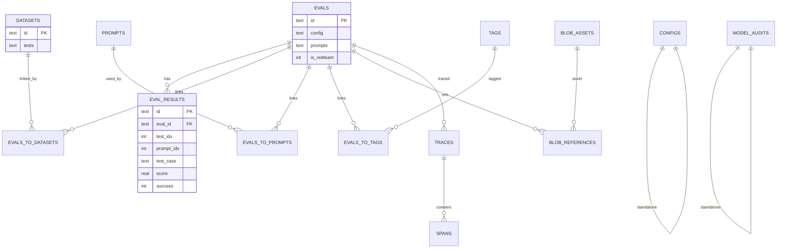

### 7.4 CRUD 实现位置

| 操作 | 位置 |
|------|------|
| Create Eval + Dataset | `Eval.create`（`models/eval.ts`）事务写 `evals`/`datasets`/`evals_to_datasets`/prompts/tags |
| Insert 单行结果 | `Eval.addResult` → `EvalResult.createFromEvaluateResult` |
| Read 详情表页 | `Eval.getTablePage`；对比侧可传 `testIndices` |
| Read 列表 | `getEvalSummaries(datasetId?, type?, includeProviders?)` |
| Update 元数据/评分 | `routes/eval.ts` PATCH、`/:evalId/results/:id/rating` |
| Delete | `Eval.delete` / `util/database` `deleteEval(s)` + `evalDeletion` 清 traces |
| Signal | `models/evalMutation` → `database/signal` |

### 7.5 一次评测的数据流

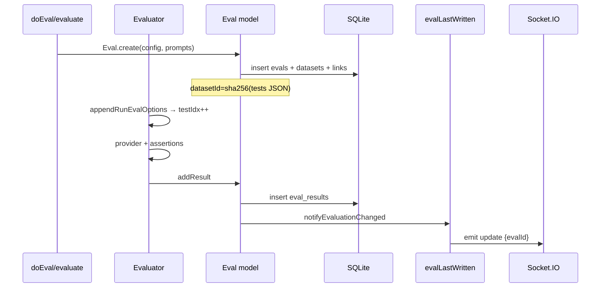

### 7.6 一次结果对比的数据流

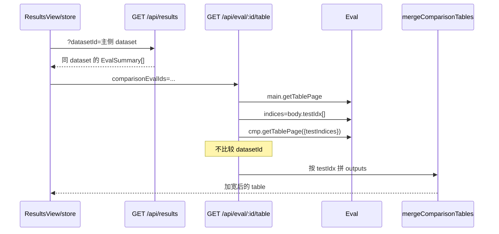

持久化侧：对比**不写库**；只读两套 `eval_results`，在内存合并后返回 / CSV。

### 7.7 与对比缺陷相关的数据事实

1. `testCase` 完整 JSON 存在行内，但 `mergeComparisonTables` **不使用**它做匹配。  
2. 仅 `tests` 顺序变化 → 新 `datasetId`（UI 通常挡掉）但 API 仍可 200 合并。  
3. 同 `datasetId` 一般意味着配置 `tests` 快照相同，**通常**展开顺序一致——这是幸福路径假设，不是服务端硬校验。

---

## 8. API 接口手册

> 路由挂载：`createApp()`（`src/server/server.ts`）。  
> Eval 子路由：`app.use('/api/eval', evalRouter)` → `src/server/routes/eval.ts`。  
> 校验：`ServerSchemas`（`types/api/server.ts`）与 `EvalSchemas`（`types/api/eval.ts`）。

### 8.1 重要接口总表

| 方法 | 路径 | 参数 | 返回值 | 处理逻辑 | 源码位置 |
|------|------|------|--------|----------|----------|
| GET | `/health` | 无 | `{ status, version }` | 进程健康；不做 Zod 强依赖 | `server.ts` ~L128 |
| GET | `/api/remote-health` | 无 | remote 健康 DTO | `checkRemoteHealth` / DISABLED | `server.ts` ~L133 |
| GET | `/api/results` | query: `datasetId?`, `type?`, `includeProviders?` | `{ data: EvalSummary[] }` | Zod → `getEvalSummaries` | `server.ts` ~L153–176；`models/eval.ts` `getEvalSummaries` |
| GET | `/api/results/:id` | `id` | `{ data: ResultsFile-ish }` | `readResult`；404 | `server.ts` ~L178 |
| GET | `/api/prompts` | 无 | prompts 缓存列表 | `promptCacheService.getAll` | `server.ts` ~L200 |
| GET | `/api/prompts/:sha256hash` | hash | 对应该 tests hash 的 prompts | `getPromptsForTestCasesHash` | `server.ts` ~L219 |
| GET | `/api/history` | `tagName?` `tagValue?` `description?` | standalone evals | `getStandaloneEvals` | `server.ts` ~L204 |
| GET | `/api/datasets` | 无 | `{ data: testCases… }` | `getTestCases` + SAS 脱敏 | `server.ts` ~L229 |
| GET | `/api/results/share/check-domain` | `id` | `{ domain, isCloudEnabled }` | `determineShareDomain` | `server.ts` ~L237 |
| POST | `/api/results/share` | body `{ id }` | `{ url }` | `createShareableUrl` | `server.ts` ~L265 |
| POST | `/api/dataset/generate` | prompts/tests | `{ results }` | `synthesizeFromTestSuite` | `server.ts` ~L305 |
| POST | `/api/eval/job` | TestSuite + options | `{ id }` | `evalJobService` + `evaluateWithSource` | `routes/eval.ts` ~L133 |
| GET | `/api/eval/job/:id` | `id` | job 进度/结果 | 内存 job map | `routes/eval.ts` ~L207 |
| GET | `/api/eval/:id/table` | 见下节 | `EvalTableDTO` / CSV / JSON 导出 | **对比主路径** | `routes/eval.ts` ~L304–460 |
| GET | `/api/eval/:id/metadata-keys` | `comparisonEvalIds?` | `{ keys }` | 校验 comparison 存在；`EvalQueries` | `routes/eval.ts` ~L462 |
| GET | `/api/eval/:id/metadata-values` | `key` | `{ values }` | metadata 取值 | `routes/eval.ts` ~L514 |
| POST | `/api/eval/:id/results` | body results[] | 204 | `eval_.setResults` | `routes/eval.ts` ~L552 |
| POST | `/api/eval/replay` | evaluationId, prompt, vars… | `{ output, error? }` | 临时 `evaluateWithSource` | `routes/eval.ts` ~L583 |
| POST | `/api/eval/:evalId/results/:id/rating` | GradingResult | 更新后的 result | 人工评分 + metrics 调整 | `routes/eval.ts` ~L714 |
| POST | `/api/eval` | v3 `data` 或 v4 body | `{ id }` | `writeResultsToDatabase` / `Eval.create` | `routes/eval.ts` ~L820 |
| PATCH | `/api/eval/:id` | table/config | success message | `updateResult` | `routes/eval.ts` ~L233 |
| PATCH | `/api/eval/:id/author` | `{ author }` | success | `eval_.save` | `routes/eval.ts` ~L257 |
| DELETE | `/api/eval/:id` | `id` | message | `deleteEval` | `routes/eval.ts` ~L874 |
| DELETE | `/api/eval` | `{ ids }` | 204 | `deleteEvals` | `routes/eval.ts` ~L900 |
| POST | `/api/eval/:id/copy` | `{ description? }` | `{ id, distinctTestCount }` | `sourceEval.copy` | `routes/eval.ts` ~L917 |
| * | `/api/providers/*` | — | provider 探测等 | `routes/providers.ts` | |
| * | `/api/configs/*` | — | 命名配置 CRUD | `routes/configs.ts` | |
| * | `/api/redteam/*` | — | redteam 生成/运行辅助 | `routes/redteam.ts` | |
| * | `/api/media/*` `/api/blobs/*` | — | 媒体与 blob | media/blobs routers | |
| * | `/api/model-audit/*` | — | model audit | `routes/modelAudit.ts` | |
| * | `/api/traces/*` | — | traces | `routes/traces.ts` | |
| * | `/api/user/*` `/api/version` | — | 用户/版本 | user/version routers | |
| POST | `/api/telemetry` | event/properties | `{ success }` | `telemetry.record` | `server.ts` ~L337 |

### 8.2 对比核心：`GET /api/eval/:id/table` 深解

#### 请求参数（`EvalSchemas.Table.Query`）

| 参数 | 作用 |
|------|------|
| `offset` / `limit` | 分页；`format` 存在时 limit 变 `UNLIMITED_RESULTS` |
| `filterMode` | all / passes / failures / errors / highlights / user-rated |
| `search` | 全文搜索（response、grader、vars…） |
| `filter` | JSON 过滤条件数组（metric/metadata/plugin…） |
| `comparisonEvalIds` | **string[]** 对比评测 ID；**无 datasetId 字段** |
| `format` | `csv` \| `json` 导出 |

#### 处理步骤（源码契约）

1. Params + Query `safeParse`；失败 400。  
2. `Eval.findById(id)`；缺失 → `404 Eval not found`。  
3. **若 `format === 'csv'`**：`generateEvalCsv(eval_, { …comparisonEvalIds, findEvalById: Eval.findById })`  
   - 内部同样按 testIdx merge；缺失 comparison → `ComparisonEvalNotFoundError` → 路由映射 `404 Comparison eval not found`。  
4. 否则 `eval_.getTablePage({ offset, limit, filterMode, search, filters })`。  
5. `indices = table.body.map(r => r.testIdx)`。  
6. 若 `comparisonEvalIds.length > 0`：  
   - 对每个 ID `findById`；收集 `getTablePage({ testIndices: indices, filterMode:'all', … })`  
   - 任一为 `null` → **整请求 404** `Comparison eval not found`  
   - **否则不检查 datasetId**，调用 `mergeComparisonTables`  
7. `format === 'json'` 则 `evalTableToJson` 下载。  
8. 有过滤时算 `filteredMetrics`（长度对齐**主** eval prompts，不含对比列）。  
9. `sendEvalTableResponse`：Zod 校验 DTO；过大则按 cell prompt 体积剥离或 413。

#### 异常对照

| 情况 | HTTP | 消息 |
|------|------|------|
| 主 eval 不存在 | 404 | Eval not found |
| comparison 不存在 | 404 | Comparison eval not found |
| Query 非法 | 400 | Zod prettify |
| 响应体过大 | 413 | Eval too large… |
| **dataset 不一致 / 顺序语义变化** | **200** | **无错误**（静默错配/缺列） |

### 8.3 `GET /api/results` 与 UI 关系

- 参数 `datasetId` 进入 `getEvalSummaries` 的 `where eq(evals_to_datasets.datasetId)`。  
- UI `EvalsTable` 在 Compare 场景再传 `filterByDatasetId` / `focusedDatasetId`，属于**列表保护**，不是 table API 的硬约束。  
- 响应字段含 `evalId`、`datasetId`、`passRate`、`label` 等（`EvalSummary`）。

### 8.4 中间件与横切

| 中间件 | 作用 |
|--------|------|
| `cors()` | 本地 dev 跨域 |
| `csrfProtection` | 写操作 CSRF（见 `middleware/csrfProtection.ts`） |
| `compression` | 响应压缩 |
| `express.json` 100mb | 大 config / results |
| 静态资源 + `/*splat` SPA | `findStaticDir()` 解析 `dist/src/app` |

### 8.5 实时通道（非 REST，但同 server）

- 连接：`socket.emit('init', { evalId } \| null)`  
- 更新：`io.emit('update', { evalId } \| { deletedEvalIds } \| null)`  
- 触发：`evalLastWritten` 文件 watcher（跨 CLI/Server 进程）

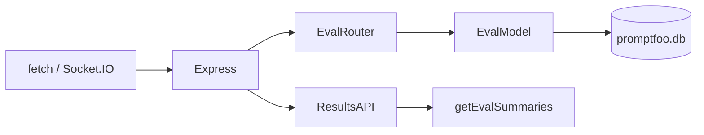

---

## 9. 测试体系

### 9.1 框架与命令

| 项 | 内容 |
|----|------|
| 主框架 | Vitest（根 `package.json` `vitest` ^5） |
| 前端 | `src/app` 内 Vitest + Testing Library；可选 browser/playwright |
| 集成 | `vitest.integration.config.ts` → `npm run test:integration` |
| Smoke | `vitest.smoke.config.ts` → `npm run test:smoke` |
| 常用命令 | `npm test` / `npm run test:coverage` / `npm run test:app` |
| HTTP 测试辅助 | `supertest`（devDependency） |
| DB 测试安全 | `getDbPath()` 拒绝测试进程打开默认 `~/.promptfoo/promptfoo.db`；`IS_TESTING` → 内存库 |

### 9.2 目录地图（与本手册相关）

```text
test/
  util/eval/evalTableUtils.test.ts     # CSV / stream / formula escape / generateEvalCsv
  server/utils/evalTableUtils.test.ts  # re-export 兼容断言（含 mergeComparisonTables 符号）
  server/routes/eval*.test.ts          # table 过滤 metrics、export、validation…
  models/eval*.test.ts                 # Eval 领域
  evaluator/**                         # 执行引擎
  providers/** assertions/**           # 海量单元
  smoke/**                             # CLI 端到端
  factories/**                         # Fake data
src/app/**/*.test.tsx                  # ResultsView / EvalSelectorDialog / EvalsTable
```

### 9.3 单元 / 集成 / Mock

| 类型 | 做法 |
|------|------|
| 单元 | 直接 import 模块；`vi.fn` mock `Eval.getTablePage` 等 |
| 路由集成 | 起 Express app + in-memory DB（待结合各 `server/routes/*.test.ts` 细化） |
| Provider Mock | 内置 `echo`；工厂 `test/factories` |
| 前端 | mock fetch；组件级 props（`filterByDatasetId`） |

### 9.4 已覆盖（与对比相关）

| 覆盖点 | 证据 |
|--------|------|
| CSV 列布局、redteam 列、formula escape (CWE-1236) | `test/util/eval/evalTableUtils.test.ts` |
| `generateEvalCsv` / `streamEvalCsv` 一致性 | 同上 |
| `server/utils/evalTableUtils` 与 node 实现同一 `mergeComparisonTables` 引用 | `test/server/utils/evalTableUtils.test.ts` |
| 前端 Compare 入口、对话框 dataset 过滤（组件测） | `ResultsView.test.tsx`、`EvalSelectorDialog.test.tsx`、`EvalsTable.test.tsx` |
| table filtered metrics 与 comparison 列宽注意 | `eval.filteredMetrics.test.ts`（注释/用例侧提到 comparison 长度） |

### 9.5 未覆盖 / 缺口（相对第 6 章缺陷）

| 缺口 | 说明 |
|------|------|
| **服务端拒绝跨 dataset 对比** | 无强制 4xx 契约测试（当前实现亦无此行为） |
| **顺序变化静默错配** | 无「同 testIdx 不同 testCase 指纹应失败/警告」的回归 |
| **table API 对比 happy/unhappy 矩阵** | 学习资料用隔离 `tmp-comparison-run` 手动复现；**不等价于仓库 CI 用例** |
| merge 函数本体专测 | 目前更多通过 re-export + CSV 路径间接涉及；**专项 misalign 用例不足**（待持续扫描确认） |

### 9.6 本次缺陷复现测试（外部学习材料，非业务源码）

路径（知识库，只读分析引用）：

- `Project-Knowledge-Base/promptfoo/03-eval-comparison-learning.md`
- `Project-Knowledge-Base/promptfoo/tmp-comparison-run/`  
  - YAML：`same-a/b.yaml`、`reordered.yaml`、`diff-ds.yaml`  
  - 响应：`api-compare-results.json`  
  - Provider：`echo`；隔离 `PROMPTFOO_CONFIG_DIR`

四场景结果见第 6.6 表。  
**本手册不把上述脚本算作仓库官方测试套件。**

### 9.7 Mock 机制摘要

```text
echo provider → 无网络 LLM
vi.mock / factories → 单元
IS_TESTING 内存 SQLite → 不污染用户库
supertest → HTTP 边界
```

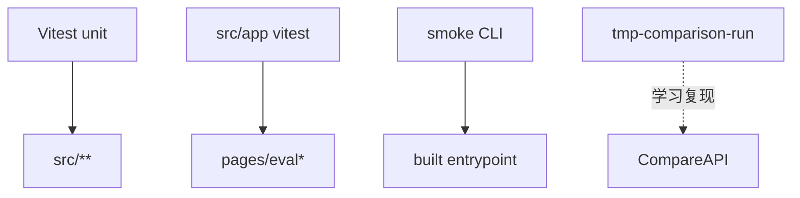

---

## 10. 源码学习路线

### 阶段一：项目入口和架构 *****

| 顺序 | 文件 | 作用 | 必须掌握 | 自测问题 |
|------|------|------|----------|----------|
| 1 | `package.json` scripts/engines | 如何跑 CLI/dev/test | Node≥22 | 为何 entry 分 dist/本地？ |
| 2 | `src/entrypoint.ts` → `main.ts` | 版本门禁与命令注册 | commander 结构 | eval/view 如何挂上？ |
| 3 | `src/server/server.ts` `createApp`/`startServer` | HTTP+SIO 骨架 | 路由挂载、signal | `/api/results` 在哪？ |
| 4 | `src/app/src/routes.tsx` | 前端路由 | SPA 与 API 关系 | `/eval/:id` 进哪组件？ |

### 阶段二：前端页面和组件 *****

| 顺序 | 文件 | 作用 | 知识点 | 自测 |
|------|------|------|--------|------|
| 1 | `pages/eval/components/store.ts` | 拉 table、comparison 参数 | Zustand + fetch | comparisonEvalIds 如何 append？ |
| 2 | `ResultsView.tsx` | Compare UI | dataset 软约束 | currentDatasetId 从哪来？ |
| 3 | `EvalSelectorDialog.tsx` + `EvalsTable.tsx` | 选择器 | filterByDatasetId | 列表 API 参数？ |
| 4 | `ResultsTable.tsx` | 表格渲染 | 宽表 outputs | 对比列如何对齐 head.prompts？ |

### 阶段三：API 和后端路由 *****

| 顺序 | 文件 | 作用 | 知识点 | 自测 |
|------|------|------|--------|------|
| 1 | `types/api/eval.ts` Table.Query | Zod 契约 | 无 dataset 字段 | 如何扩校验？ |
| 2 | `routes/eval.ts` GET `/:id/table` | 对比路径 | 404 vs 200 | indices 怎来？ |
| 3 | `server.ts` GET `/api/results` | 列表 | getEvalSummaries | dataset 过滤 SQL？ |

### 阶段四：业务执行逻辑 *****

| 顺序 | 文件 | 作用 | 知识点 | 自测 |
|------|------|------|--------|------|
| 1 | `commands/eval.ts` + `node/doEval.ts` | CLI 入口 | 配置加载 | write 结果开关？ |
| 2 | `evaluate.ts` | 编排 | options | 与 Eval 实例关系？ |
| 3 | `evaluator.ts` `appendRunEvalOptionsForTestCase` | **testIdx 分配** | 展开矩阵 | repeat/var 如何占行？ |
| 4 | `providers/index.ts` + `echo` | 模型调用 | ApiProvider | 如何本地 smoke？ |
| 5 | `assertions/index.ts` | 断言 | GradingResult | failureReason 枚举？ |

### 阶段五：数据库和数据流 *****

| 顺序 | 文件 | 作用 | 知识点 | 自测 |
|------|------|------|--------|------|
| 1 | `database/tables.ts` | schema | ER | eval_results 主键？ |
| 2 | `database/index.ts` | getDb | WAL/测试保护 | 默认库路径？ |
| 3 | `models/eval.ts` create/find/getTablePage/getEvalSummaries | 领域 CRUD | dataset 哈希 | version 3 vs 4？ |
| 4 | `models/evalResult.ts` | 行持久化 | metadata | testIdx 字段名？ |

### 阶段六：评测结果对比 *****

| 顺序 | 文件/材料 | 作用 | 知识点 | 自测 |
|------|-----------|------|--------|------|
| 1 | 第 6 章 + learning.md | 设计/实测 | 软硬约束 | 为何 UI 拦不住 API？ |
| 2 | `evalTableUtils.ts` `mergeComparisonTables`/`generateEvalCsv` | 合并 | testIdx only | 缺行如何表现？ |
| 3 | `tmp-comparison-run/api-compare-results.json` | 真响应 | 四场景 | reordered 为何错配？ |

### 阶段七：测试和异常处理 ****

| 顺序 | 文件 | 作用 | 知识点 | 自测 |
|------|------|------|--------|------|
| 1 | `test/util/eval/evalTableUtils.test.ts` | CSV 质量/安全 | formula escape | 如何加 misalign 用例？ |
| 2 | `routes/eval.ts` `sendEvalTableResponse` | 413/strip | 大 payload | 二分剥离策略？ |
| 3 | Provider/error 路径 | 行级 ERROR | 非瞬时 HTTP 中止 | 对比是否看 success？ |

**优先级图例**：***** 必读主链 → * 扩展能力（redteam/MCP/code-scan 可后置）。

---

## 11. 面试知识库

> 仅列与本仓库主链/对比强相关点。

### 11.1 JavaScript / TypeScript

| 点 | 项目位置 | 原理 | 面试问 | 追问 | 易混 |
|----|----------|------|--------|------|------|
| ESM + dual package | `package.json` exports | import/require 双轨 | 如何发 npm 库？ | contracts 子路径 | CJS interop |
| Zod 4 契约 | `types/api/*` | safeParse 边界 | 为何不靠 TS 类型？ | passthrough 保留 provider 嵌套 | class-validator |
| `JSON.stringify` 哈希稳定性 | `Eval.create` datasetId | 键序依赖引擎插入序 | 哈希稳定性？ | 展开后 suite 不一致风险 | content-hash vs config-hash |
| structuredClone | Eval.copy | 深拷 | 与 lodash cloneDeep | 不可克隆类型 | |

### 11.2 前端框架

| 点 | 位置 | 原理 | 问 | 追问 | 易混 |
|----|------|------|----|------|------|
| Zustand vs React Query | store / hooks | 结果表会话态 vs 服务端列表缓存 | 为何结果表用 store？ | 对比态为何不放 URL 主键外 | Redux |
| React 19 + Compiler babel 插件 | app package | 自动 memo 趋势 | compiler 边界 |  | Next 专属 |
| Radix Dialog | EvalSelector | a11y 焦点陷阱 | controlled open | | Headless UI |
| Virtualized table | tanstack virtual | 大结果集 | overscan | | window |

### 11.3 前端工程化

| 点 | 位置 | 原理 | 问 | 追问 | 易混 |
|----|------|------|----|------|------|
| Vite monorepo workspace | root + `src/app` | app 独立 package | 产物到 `dist/src/app` | | CRA |
| Biome + Prettier 分工 | scripts | JS/TS vs md/yaml | 为何两套 | | ESLint only |
| 环境变量前缀 | Vite `VITE_PUBLIC_*` | 编译期注入 | API base 如何切 dev | 误提交 secret | Next `NEXT_PUBLIC` |

### 11.4 HTTP / API

| 点 | 位置 | 原理 | 问 | 追问 | 易混 |
|----|------|------|----|------|------|
| Express 5 | server | routing `/*splat` | 与 4 差异 | | Fastify |
| Query 数组 `comparisonEvalIds` | store append | 重复 key | 如何建模 multi-id | | body POST 对比 |
| CSRF + CORS | middleware | 本地信任边界 | 为何本地 CORS * | share 无 rate limit 的设计取舍（代码注释） | 纯 token API |
| 大 JSON 413 降级 | sendEvalTableResponse | 二分 strip prompt | 如何保护 Node 堆 | | gzip only |

### 11.5 后端架构

| 点 | 位置 | 原理 | 问 | 追问 | 易混 |
|----|------|------|----|------|------|
| CLI 与 Server 同模型 | Eval model | 文件系统信号跨进程 | 为何不用只 DB trigger | Socket 合并策略 | 微服务拆分 |
| Job 内存 map | evalJobService | 无分布式队列 | 重启丢 job？ | | BullMQ |
| 领域模型贫血 vs 厚模型 | `models/eval.ts` 巨大 | 过滤 SQL 集中 | 单文件过大如何拆 | | Repository 纯净 |

### 11.6 数据库

| 点 | 位置 | 原理 | 问 | 追问 | 易混 |
|----|------|------|----|------|------|
| SQLite + WAL | getDb | 本机单写多读 | 与 Postgres 选型 | 网络盘 WAL 失败 | pure better-sqlite3 主路径（**不是**） |
| Drizzle sql 模板 | buildFilterWhereSql | 防注入 | 动态 filter 如何安全 | json_each | 字符串拼 SQL |
| 序列化操作队列 | serializeTopLevelOperations | 避免 libsql 锁 | 为何 concurrency 1 | 事务嵌套 ALS | |
| dataset 内容寻址 | sha256 tests | 去重 | 顺序敏感？ | **是** | 用户级 Dataset 实体 |

### 11.7 AI / LLM 评测

| 点 | 位置 | 原理 | 问 | 追问 | 易混 |
|----|------|------|----|------|------|
| Provider 适配器 | providers/* | callApi 统一 | 如何加新厂商 | optional peer dep | LangChain 全家桶必选 |
| Assertions 分级 | ASSERT vs ERROR | 失败原因 | score 与 pass 关系 | human override | 单元测试 assert |
| testIdx 语义 | evaluator | **结果表行号** 非原始下标 | 对比用它是否稳 | var 展开 | dataset 行号 |
| 对比契约 | mergeComparisonTables | 索引对齐 | 服务端校验？ | **当前无** | 用例指纹对齐 |

### 11.8 测试与 Mock

| 点 | 位置 | 原理 | 问 | 追问 | 易混 |
|----|------|------|----|------|------|
| echo provider | providers/echo | 确定性输出 | 如何测无密钥路径 | smoke | MSW 必须 |
| 公式注入测试 | escapeCsvFormula | CWE-1236 | 导出安全 | disable env | XSS |
| 测试拒默认库 | getDbPath | 防误伤用户数据 | CI 隔离 | | 同一文件多进程 |

### 11.9 系统设计

| 点 | 位置 | 原理 | 问 | 追问 | 易混 |
|----|------|------|----|------|------|
| UI 约定 vs API 硬约束 | 第 6 章 | 防御层次 | 哪里做权威校验 | 对比应在 server | 前端校验足够论 |
| 索引对齐 vs 内容对齐 | testIdx vs testCase hash | 实现成本 | 如何设计 v2 对比 | 分页下如何 content join | JOIN 主键想当然 |
| 本地优先 + 可选分享 | share routes | 信任边界不同 | 本地 API 暴露风险 | CSRF/绑定 127.0.0.1 | 公有 SaaS 同构 |

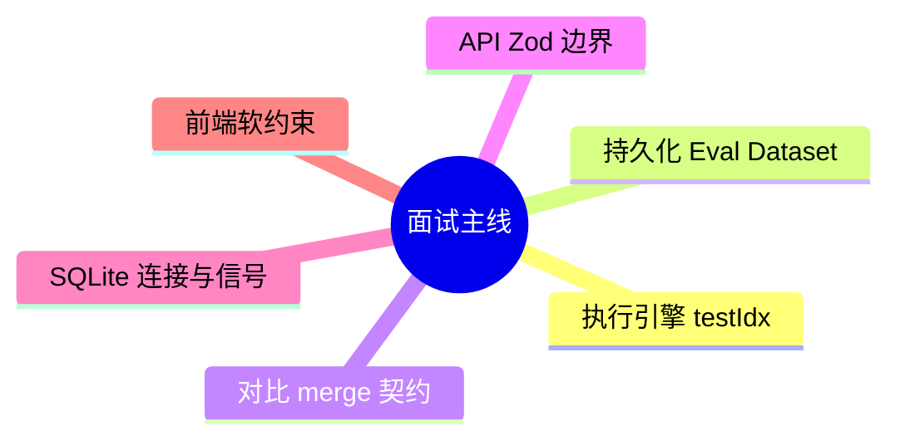

---

## 附录 A：关键符号速查

| 符号 | 文件 |
|------|------|
| `createApp` / `startServer` | `src/server/server.ts` |
| `evalRouter` GET `/:id/table` | `src/server/routes/eval.ts` |
| `getEvalSummaries` | `src/models/eval.ts` |
| `Eval.create` / `getTablePage` | `src/models/eval.ts` |
| `mergeComparisonTables` | `src/util/eval/evalTableUtils.ts`（server 侧 re-export） |
| `ComparisonEvalNotFoundError` | 同上 |
| `Evaluator` / `appendRunEvalOptionsForTestCase` | `src/evaluator.ts` |
| `filterByDatasetId` | `ResultsView` → `EvalSelectorDialog` → `EvalsTable` |

## 附录 B：文档元信息

| 项 | 内容 |
|----|------|
| 手册路径 | `docs/TECHNICAL-GUIDE.md`（相对仓库根 `promptfoo-main/`） |
| 对照学习材料 | `Project-Knowledge-Base/promptfoo/03-eval-comparison-learning.md`、`tmp-comparison-run/` |
| 业务源码修改 | **无**（只写文档） |
| 缺陷修复 | **未实施**；第 6 章明确四分法 |
| 版本锚点 | 根 `package.json` version **0.124.1**（分析时读取） |

## 附录 C：完成报告

1. **读取的核心源码文件（代表性，非穷尽）**  
   `package.json`、`src/app/package.json`、`src/server/server.ts`、`src/server/routes/eval.ts`、`src/server/utils/evalTableUtils.ts`、`src/util/eval/evalTableUtils.ts`、`src/database/index.ts`、`src/database/tables.ts`、`src/models/eval.ts`（大段）、`src/app/.../ResultsView.tsx` / `store.ts` / `EvalsTable.tsx` / `EvalSelectorDialog.tsx`（Ch1–6 已引用）、`test/util/eval/evalTableUtils.test.ts`、`test/server/utils/evalTableUtils.test.ts`；对照 `03-eval-comparison-learning.md`、`tmp-comparison-run/*`。

2. **识别的核心模块数量（约）**：**18+**  
   CLI/entrypoint、doEval、evaluate、evaluator、providers、assertions、models/eval、models/evalResult、database、server、routes/eval、evalJobService、evalTableUtils、app routes、ResultsView/store、EvalsTable、signal/Socket.IO、datasets 关联等。

3. **梳理的关键调用链数量（约）**：**10+**  
   配置→eval 执行；结果落库；列表；详情 table；Compare UI；table merge；CSV 对比导出；Web job；Socket 更新；删除/copy 等。

4. **第三方依赖及使用位置**  
   见第 2 章表（express/drizzle/libsql/zod/react/zustand/vite…）；强调 **libsql 主路径** 与 **better-sqlite3 非主读写**；前端热点 **fetch 非 axios**。

5. **Mermaid 图数量（约）**：**15+**（第1架构、第4多幅、第5–6流程、第7 ER/数据流、第8 通信、第9 测试、第10 隐含阶段、第11 mindmap 等）。

6. **已完成章节**  
   1–11 全部；含附录 A/B/C 完成报告。

7. **尚未确认 / 待核实**  
   - `evaluator.ts` / 前端组件**精确行号**随版本漂移，正文多用「~行号」+ 符号名；打开 IDE 请以当前文件搜索符号为准。  
   - `mergeComparisonTables` 是否有更完整单测矩阵：当前明确见到 CSV/re-export 覆盖，**专项错配回归仍属缺口**。  
   - redteam/MCP/code-scan 仅架构级点到，未按第 5 章同等深度逐函数拆。  
   - lock 文件精确 resolve 版本未逐条钉死（以 package.json 范围 +「以 lock 为准」说明）。  
   - 部分 UI 行号来自前期分析缓存，若本地有未提交改动需重搜。

8. **源码与文档不一致**  
   - 无故意「已修复对比缺陷」的表述；与 learning 材料一致：**缺陷仍存在**。  
   - 产品对外名在手册标题使用学习名称；技术标识保留源码 `PROMPTFOO_*` 等。  
   - `server/utils/evalTableUtils` 仅为 re-export——若他处文档写「逻辑在 server/utils」则不准确；**实现在 `src/util/eval/evalTableUtils.ts`**。

9. **是否修改业务源码**：**否**（仅写入/更新本手册）。

10. **最终文件路径**：`promptfoo-main/docs/TECHNICAL-GUIDE.md`

---

*全文结束。按第 10 章路线打开 IDE，用符号搜索比死记行号更稳。*


